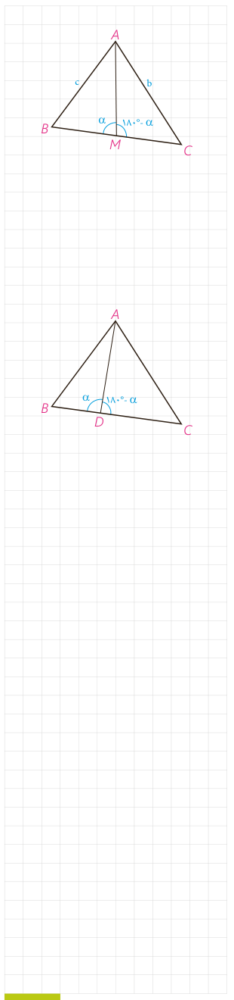

۴- در مثلث $ABC$، میانۀ $AM$ را رسم کرده‌ایم ($MB=MC=\frac a2$). با نوشتن قضیۀ کسینوس‌ها در دو مثلث $AMB$ و $AMC$، $b^2$ و $c^2$ را محاسبه، و با جمع کردن دو تساوی حاصل، درستی تساوی زیر را ثابت کنید:

$$b^2+c^2=2AM^2+\frac{a^2}{2}\qquad\text{(قضیۀ میانه‌ها)}$$

در حالت خاص $AB=4$ و $AC=6$ و $BC=8$، طول میانۀ $AM$ را به‌دست آورید.

۵- در مثلث $ABC$، نقطۀ دلخواه $D$ روی $BC$ مفروض است. به کمک قضیۀ کسینوس‌ها در دو مثلث $ADB$ و $ADC$ درستی تساوی زیر را ثابت کنید:

$$AB^2\cdot DC+AC^2\cdot DB=AD^2\cdot BC+DB\cdot DC\cdot BC\qquad\text{(قضیۀ استوارت)}$$

به کمک قضیۀ استوارت، درستی قضیۀ میانه‌ها را نتیجه‌گیری کنید.

۶- مسئلۀ ۲ را بار دیگر، این بار به کمک قضیۀ استوارت حل کنید.

