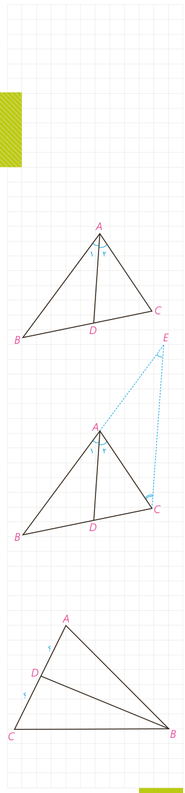

# درس سوم: قضیۀ نیمسازهای زوایای داخلی و محاسبۀ طول نیمسازها

## ۱- قضیۀ نیمسازهای زوایای داخلی

**قضیۀ ۱:** در هر مثلث، نیمساز هر زاویۀ داخلی، ضلع روبه‌رو به آن زاویه را به نسبت اندازه‌های ضلع‌های آن زاویه تقسیم می‌کند.

فرض: $\widehat A_1=\widehat A_2$؛ حکم: $\frac{AB}{AC}=\frac{BD}{CD}$.

**اثبات:** مطابق شکل از نقطۀ $C$ خطی موازی نیمساز $AD$ رسم می‌کنیم تا امتداد $AB$ را در نقطۀ $E$ قطع کند.

الف) چرا $\widehat A_1=\widehat E$ و چرا $\widehat A_2=\widehat C$؟

ب) با توجه به فرض، چه نتیجه‌ای دربارۀ زوایای $E$ و $C$ می‌توان گرفت؟ مثلث $AEC$ چه نوع مثلثی است؟

پ) با توجه به قضیۀ تالس در مثلث $EBC$ ($AD\parallel EC$) نسبت $\frac{BD}{CD}$ با کدام نسبت برابر است؟ با توجه به نتیجۀ قسمت (ب) اثبات را کامل کنید:

$$AD\parallel EC\Rightarrow\frac{BD}{CD}=\frac{AB}{\ldots}=\frac{\ldots}{\ldots}$$

یکی از نتایج فوری این قضیه این است که در هر مثلث به سادگی می‌توان طول‌های قطعاتی را که هر نیمساز روی ضلع مقابل ایجاد می‌کند با داشتن طول‌های اضلاع مثلث، محاسبه کرد:

**مثال:** در مثلث $ABC$، $AB=7$، $AC=5$ و $BC=8$ است. طول‌های دو قطعه‌ای را به‌دست آورید که نیمساز زاویۀ $B$ روی ضلع مقابل ایجاد می‌کند.

**حل:**

$$\frac{AB}{BC}=\frac{AD}{CD}=\frac78\Rightarrow\frac{AD+CD}{CD}=\frac{7+8}{8}\Rightarrow\frac{AC}{CD}=\frac{15}{8}$$
$$CD=\frac{8\times5}{15}=\frac83,\quad AD=AC-CD=5-\frac83=\frac73$$

