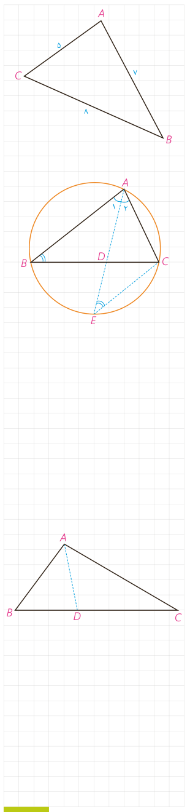

## کار در کلاس

در شکل روبه‌رو نیمساز زاویۀ $C$ را رسم کنید و طول‌های دو قطعه‌ای را به‌دست آورید که این نیمساز روی $AB$ جدا می‌کند.

## ۲- محاسبۀ طول نیمسازهای زوایای داخلی مثلث

در مثلث $ABC$ برای محاسبۀ طول نیمساز داخلی زاویۀ $\widehat A$ ($\widehat A_1=\widehat A_2$)، یعنی $AD$، $AD$ را امتداد می‌دهیم تا دایرۀ محیطی مثلث را در $E$ قطع کند و $E$ را به $C$ وصل می‌کنیم.

الف) چرا $\widehat E=\widehat B$؟

ب) چرا مثلث‌های $ABD$ و $AEC$ متشابه‌اند؟

پ) نسبت‌های اضلاع متناظر آنها را بنویسید.

$$\frac{AC}{\ldots}=\frac{AE}{\ldots}=\frac{\ldots}{BD}$$

ت) از تناسب اول نتیجه می‌گیریم:

$$AB\cdot AC=AD\cdot AE=AD(AD+DE)=AD^2+AD\cdot DE$$

و چون $AD\cdot DE=BD\cdot DC$ (چرا؟) بنابراین: $AD^2=AB\cdot AC-BD\cdot DC$.

**قضیۀ ۲:** در هر مثلث، مربع اندازۀ هر نیمساز داخلی برابر است با حاصل‌ضرب اندازۀ دو ضلع زاویه، منهای حاصل‌ضرب اندازۀ دو قطعه‌ای که نیمساز روی ضلع مقابل ایجاد می‌کند.

**مثال:** در مثلث $ABC$، $AB=3$، $AC=5$ و $BC=7$ است. طول نیمساز زاویۀ $A$ را بیابید.

**حل:** به کمک قضیۀ (۱) طول‌های $BD$ و $CD$ را به‌دست می‌آوریم:

$$\frac{BD}{CD}=\frac{AB}{AC}=\frac35\Rightarrow\frac{BD+CD}{CD}=\frac85\Rightarrow\frac{BC}{CD}=\frac85\Rightarrow\frac7{CD}=\frac85\Rightarrow CD=\frac{35}{8},\quad BD=7-\frac{35}{8}=\frac{21}{8}$$

حال با توجه به قضیۀ (۲) داریم:

$$AD^2=AB\cdot AC-BD\cdot CD=3\times5-\frac{35}{8}\times\frac{21}{8}=15-\frac{735}{64}=\frac{225}{64}\Rightarrow AD=\frac{15}{8}$$

