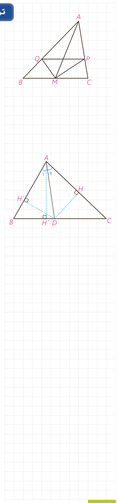

## تمرین

۱- در مثلث $ABC$، $M$ وسط $BC$ و $MP$ و $MQ$ نیمسازهای زوایای $AMC$ و $AMB$ هستند؛ ثابت کنید: $PQ\parallel BC$.

۲- در مثلث $ABC$، $AB=7$ و $AC=4$ و $BC=10$ است. طول نیمساز زاویۀ داخلی $C$ را به‌دست آورید.

۳- با پر کردن جاهای خالی با فرض اینکه در شکل مقابل $AD$ نیمساز زاویۀ $\widehat A$ است، روش دیگری برای اثبات قضیۀ نیمسازهای زوایای داخلی ارائه کنید:

الف) چرا $DH=DH'$؟

ب)

$$\frac{S_{ABD}}{S_{ACD}}=\frac{\frac12DH'\times\ldots}{\frac12DH\times\ldots}=\frac{\ldots}{\ldots}\qquad(1)$$
$$\frac{S_{ABD}}{S_{ACD}}=\frac{\frac12BD\times\ldots}{\frac12CD\times\ldots}=\frac{\ldots}{\ldots}\qquad(2)$$

از مقایسۀ (۱) و (۲) نتیجه می‌شود: $\frac{\ldots}{\ldots}=\frac{\ldots}{\ldots}$.

