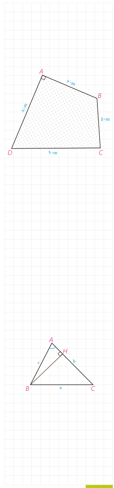

و طول‌های سه ارتفاع مثلث نیز برابرند با:

$$h_a=\frac{2S}{a}=\frac{2\times84}{14}=12,\quad h_b=\ldots,\quad h_c=\ldots$$

## کار در کلاس

چهارضلعی $ABCD$ یک مزرعۀ کشاورزی را نشان می‌دهد که تنها دو ضلع آن بر هم عمودند. طول‌های اضلاع زمین به سادگی قابل اندازه‌گیری، و اندازه‌های آنها در شکل مشخص شده است. با انجام دادن مراحل زیر مساحت این زمین را به‌دست آورید:

الف) اگر $B$ را به $D$ وصل کنیم، طول $BD$ را چگونه به‌دست می‌آورید؟

$$BD^2=\ldots+\ldots=\ldots+\ldots=\ldots\Rightarrow BD=\ldots$$

ب) مساحت مثلث $ABD$ را چگونه به‌دست می‌آورید؟

$$S_{ABD}=\frac{\ldots\times\ldots}{2}=\ldots$$

پ) مساحت مثلث $CBD$ را به کمک دستور هرون به‌دست آورید.

$$P=\frac{\ldots+\ldots+\ldots}{2}=\ldots,\quad S_{CBD}=\ldots$$

ت) مساحت زمین کشاورزی برابر است با: $S=\ldots+\ldots=\ldots$.

## فعالیت

می‌خواهیم دستور دیگری برای محاسبۀ مساحت مثلث به کمک نسبت‌های مثلثاتی به‌دست آوریم.

۱- در مثلث $ABC$، ارتفاع $BH$ را رسم کرده‌ایم.

$$\sin A=\frac{\ldots}{\ldots}\Rightarrow BH=\ldots$$

۲- مساحت مثلث $ABC$ را به کمک ارتفاع $BH$ بنویسید.

$$S_{ABC}=\frac12BH\times AC=\ldots$$

**نتیجه:** مساحت هر مثلث برابر است با نصف حاصل‌ضرب اندازه‌های هر دو ضلع در سینوس زاویۀ بین آنها:

$$S_{ABC}=\frac12bc\sin A=\frac12ab\sin C=\frac12ac\sin B$$

