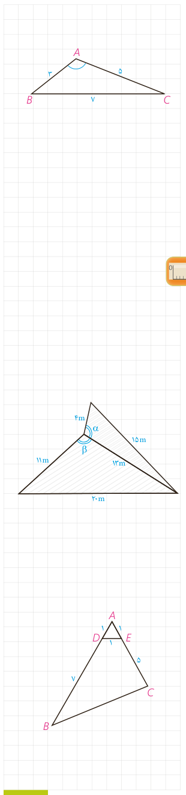

## کار در کلاس

۱- مثلث $ABC$ با اضلاع ۳ و ۵ و ۷ مفروض است. مساحت مثلث را با استفاده از دستور هرون به‌دست آورید.

$$P=\frac{\ldots+\ldots+\ldots}{2}=\ldots\Rightarrow S=\sqrt{P(P-a)(P-b)(P-c)}=\ldots$$

۲- مساحت مثلث را با استفاده از دستور $S=\frac12AB\cdot AC\cdot\sin A$ بنویسید.

۳- از مقایسۀ نتایج ۱ و ۲، اندازۀ زاویۀ منفرجۀ $\widehat A$ را به‌دست آورید.

## تمرین

۱- در مثلث $ABC$، $AB=10$، $AC=6$ و $\widehat A=60^\circ$. الف) طول $BC$ را به‌دست آورید. ب) مساحت مثلث را تعیین کنید. پ) مقدار $\sin B$ را پیدا کنید.

۲- دو زمین کوچک به شکل مثلث با یک دیوار به طول ۱۳ متر مطابق شکل از هم جدا شده‌اند. ابعاد زمین‌ها هم در شکل مشخص شده‌اند. اگر با برداشتن دیوار، دو زمین به یک زمین تبدیل شود، مساحت آن چقدر می‌شود؟ نشان دهید دیوار مشترک با اضلاع ۴ متری و ۱۱ متری زاویه‌های برابر می‌سازد. ($\alpha=\beta$)

۳- دستور محاسبۀ مساحت مثلث متساوی‌الاضلاع به ضلع $a$ را به کمک دستور هرون به‌دست آورید.

۴- در شکل مقابل، اولاً طول $BC$ را به‌دست آورید. ثانیاً مساحت چهارضلعی $DECB$ را بیابید.

۵- در شکل صفحه بعد $AD$ نیمساز زاویۀ $\widehat A$ است. با پر کردن جاهای خالی، دستوری دیگر برای محاسبۀ طول نیمساز زاویۀ $A$ به‌دست آورید.

