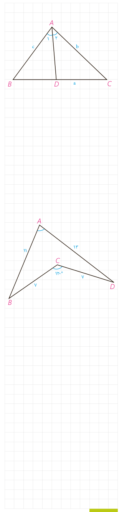

$$S_{ABC}=S_{ABD}+S_{ACD}\Rightarrow$$
$$\frac12AB\cdot AC\cdot\sin A=\frac12\ldots\times\ldots\times\sin\frac A2+\frac12\ldots\times\ldots\times\sin\frac A2$$
$$\Rightarrow AB\cdot AC\cdot\sin A=AD\cdot\sin\frac A2(\ldots+\ldots)$$
$$\Rightarrow AD=\frac{AB\cdot AC\cdot\sin A}{(\ldots+\ldots)\sin(A/2)}=\frac{2AB\cdot AC\cdot\sin(A/2)\cos(A/2)}{(\ldots+\ldots)\sin(A/2)}$$
$$\Rightarrow AD=\ldots\Rightarrow d_a\;(\text{نیمساز رأس }A)=\frac{2bc\cos(A/2)}{b+c}$$

۶- در مثلث $ABC$ به اضلاع ۵ و ۶ و ۷ سانتی‌متر، نقطه‌ای که از اضلاع به طول‌های ۵ و ۶، به فاصلۀ ۲ و ۳ سانتی‌متر است از ضلع بزرگ‌تر چه فاصله‌ای دارد؟

راهنمایی: از مساحت مثلث استفاده کنید.

۷- در شکل، اولاً اندازۀ زاویۀ $A$ را به‌دست آورید. ثانیاً مساحت چهارضلعی $ABCD$ را بیابید.

راهنمایی: $B$ را به $D$ وصل کنید.

۸- ثابت کنید مساحت هر متوازی‌الاضلاع برابر است با حاصل‌ضرب دو ضلع مجاور در سینوس زاویۀ بین آن دو ضلع.

۹- به کمک قضیۀ کسینوس‌ها ثابت کنید در مثلث $ABC$:

الف) $\widehat A>90^\circ$ اگر و تنها اگر $a^2>b^2+c^2$.

ب) $\widehat A<90^\circ$ اگر و تنها اگر $a^2<b^2+c^2$.

پ) $\widehat A=90^\circ$ اگر و تنها اگر $a^2=b^2+c^2$.

۱۰- به کمک نتیجۀ تمرین ۹، حاده (تند)، قائمه یا منفرجه (باز) بودن زاویۀ $A$ را در هر یک از مثلث‌های زیر تعیین کنید:

الف) $AB=10$، $AC=6$، $BC=9$.
ب) $AB=8$، $AC=4$، $BC=9$.
پ) $AB=8$، $AC=15$، $BC=17$.

