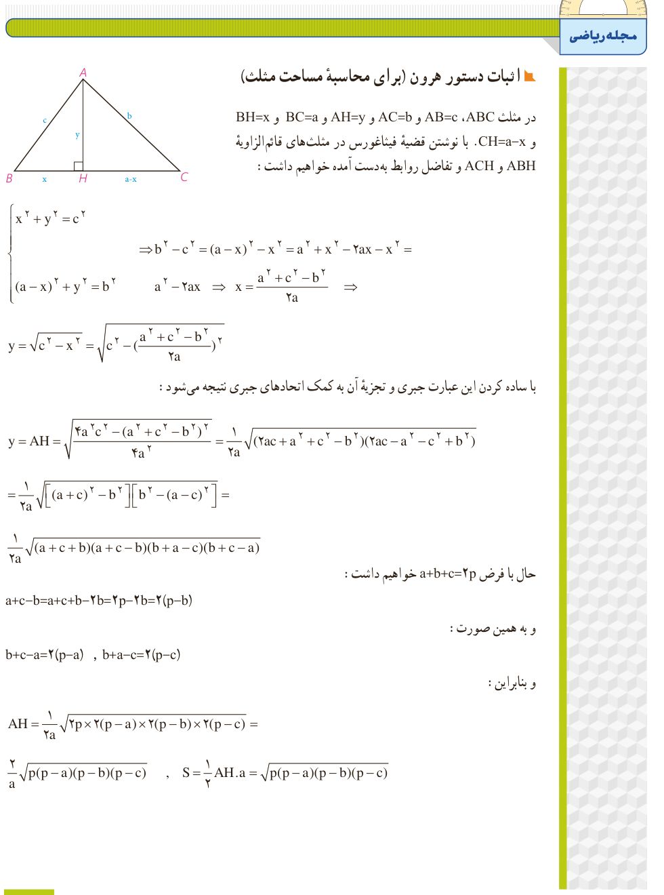

# مجلۀ ریاضی

## اثبات دستور هرون (برای محاسبۀ مساحت مثلث)

در مثلث $ABC$، $AB=c$ و $AC=b$ و $AH=y$ و $BC=a$ و $BH=x$ و $CH=a-x$. با نوشتن قضیۀ فیثاغورس در مثلث‌های قائم‌الزاویۀ $ABH$ و $ACH$ و تفاضل روابط به‌دست آمده خواهیم داشت:

$$\left\{\begin{aligned}x^2+y^2&=c^2\\(a-x)^2+y^2&=b^2\end{aligned}\right.\Rightarrow b^2-c^2=(a-x)^2-x^2=a^2+x^2-2ax-x^2=a^2-2ax$$
$$\Rightarrow x=\frac{a^2+c^2-b^2}{2a}$$
$$y=\sqrt{c^2-x^2}=\sqrt{c^2-\left(\frac{a^2+c^2-b^2}{2a}\right)^2}$$

با ساده کردن این عبارت جبری و تجزیۀ آن به کمک اتحادهای جبری نتیجه می‌شود:

$$y=AH=\sqrt{\frac{4a^2c^2-(a^2+c^2-b^2)^2}{4a^2}}=\frac1{2a}\sqrt{(2ac+a^2+c^2-b^2)(2ac-a^2-c^2+b^2)}$$
$$=\frac1{2a}\sqrt{[(a+c)^2-b^2][b^2-(a-c)^2]}$$
$$=\frac1{2a}\sqrt{(a+c+b)(a+c-b)(b+a-c)(b+c-a)}$$

حال با فرض $a+b+c=2p$ خواهیم داشت:

$$a+c-b=a+c+b-2b=2p-2b=2(p-b)$$

و به همین صورت: $b+c-a=2(p-a)$، $b+a-c=2(p-c)$.

بنابراین:

$$AH=\frac1{2a}\sqrt{2p\times2(p-a)\times2(p-b)\times2(p-c)}=\frac2a\sqrt{p(p-a)(p-b)(p-c)}$$
$$S=\frac12AH\cdot a=\sqrt{p(p-a)(p-b)(p-c)}$$

