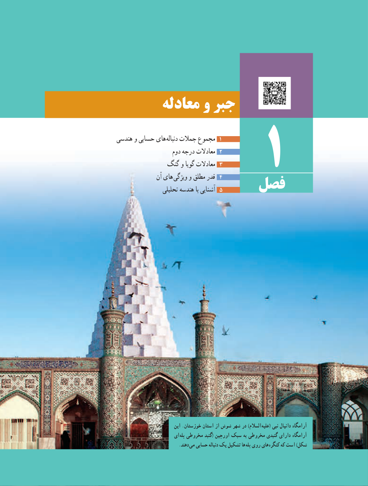

# فصل ۱: جبر و معادله

۱. مجموع جملات دنباله‌های حسابی و هندسی  
۲. معادلات درجه دوم  
۳. معادلات گویا و گنگ  
۴. قدر مطلق و ویژگی‌های آن  
۵. آشنایی با هندسه تحلیلی

آرامگاه دانیال نبی (علیه‌السلام) در شهر شوش از استان خوزستان. این آرامگاه دارای گنبدی مخروطی به سبک اورچین (گنبد مخروطی پله‌ای شکل) است که کنگره‌های روی پله‌ها تشکیل یک دنباله حسابی می‌دهند.
