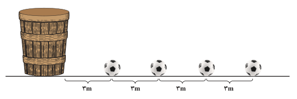

# صفحهٔ ۴

## کار در کلاس

۱. نشان دهید در یک دنباله حسابی اگر $a_1$ و $a_n$ به‌ترتیب جملات اول و آخر باشند آنگاه:

$$S_n=\frac n2(a_1+a_n)$$

۲. مجموع همه عددهای طبیعی دو رقمی مضرب ۴ را به‌دست آورید.

**مثال:** در یک مسابقه تعداد بسیاری توپ روی یک خط مستقیم و هر یک به فاصله ۳ متر از هم قرار دارند. فاصله توپ اول تا سبد نیز ۳ متر است (شکل زیر). دونده‌ای باید از کنار سبد شروع کرده توپ اول را بردارد و آن را تا سبد حمل کند و به سبد بیندازد، سپس به طرف توپ بعدی بدود و آن را بردارد و به داخل سبد بیندازد و این کار را ادامه دهد. اگر این دونده در پایان ۹۱۸ متر دویده باشد؛ حساب کنید او جمعاً چند توپ در سبد انداخته است؟

**حل:** دونده برای برداشتن توپ اول و قرار دادن آن در سبد باید مسافت $3+3=6$ متر را طی کند؛ برای توپ دوم نیز باید ۱۲ متر و برای توپ سوم ۱۸ متر و ... طی کند. بنابراین مسافت‌های طی شده در این مراحل، تشکیل یک دنباله حسابی با جمله اول ۶ و قدر نسبت ۶ می‌دهد. اگر $n$ تعداد توپ‌های انداخته شده در سبد باشد از فرمول مجموع جملات دنباله حسابی داریم:

$$S=\frac n2(2a+(n-1)d)$$
$$918=\frac n2(12+(n-1)6)\Rightarrow306=n(n+1)\Rightarrow17\times18=n(n+1)\Rightarrow n=17$$

## مجموع جملات دنباله هندسی

### فعالیت

۱. قدر نسبت و مجموع $n$ جمله اول دنباله هندسی زیر را به‌دست آورید. $(a\ne0)$

$$a,a,a,\ldots,a$$

۲. دنباله هندسی زیر را در نظر بگیرید. $(q\ne1)$

$$a,aq,aq^2,\ldots$$

الف) جمله $n$ام دنباله چیست؟
