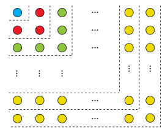

# صفحهٔ ۶

## کار در کلاس

در داستان مخترع شطرنج اگر در خانه اول یک دانه گندم و در خانه دوم دو دانه گندم و به همین صورت در هر خانه دو برابر خانه قبلی گندم قرار دهیم و اگر هر دانه گندم را یک گرم در نظر بگیریم:

الف) این جایزه چند گرم می‌شود؟¹

ب) نشان دهید جایزه او بیش از ۱۰۰۰ میلیارد تُن خواهد شد.

## تمرین

۱. الف) به کمک شکل روبه‌رو حاصل عبارت زیر را به‌دست آورید.

$$1+3+5+\cdots+(2n-1)=$$

ب) اکنون با استفاده از فرمول درستی جواب خود در قسمت الف را بررسی کنید.

۲. مجموع همه اعداد طبیعی سه رقمی که مضرب شش هستند چقدر می‌شود؟

۳. در دنباله حسابی $5,8,11,\ldots$ حداقل چند جمله آن را با هم جمع کنیم تا حاصل آن از ۴۹۳ بیشتر شود؟

۴. در ۲۰ جمله اول یک دنباله حسابی مجموع جملات شماره‌های فرد ۱۳۵ و مجموع جملات شماره‌های زوج ۱۵۰ می‌باشد. جمله اول و قدر نسبت دنباله را مشخص کنید.

۵. جمله عمومی یک دنباله به‌صورت $a_n=2^{n-1}$ است. چند جمله از این دنباله را با هم جمع کنیم تا مجموع آنها برابر ۲۵۵ شود؟

۶. طول ضلع مربعی یک متر است. ابتدا نیمی از مساحت مربع را رنگ می‌کنیم. سپس نیمی از مساحت باقی‌مانده را و به همین ترتیب در هر مرحله نیمی از مساحت باقی‌مانده از قبل را رنگ می‌کنیم. پس از دست کم چند مرحله حداقل ۹۹ درصد سطح مربع رنگ شده است؟

۷. برای عدد حقیقی $a$ ($a\ne1$) و عدد طبیعی $n$:

الف) حاصل عبارت زیر را به‌دست آورید.

$$1+a+a^2+\cdots+a^{n-1}$$

ب) با استفاده از قسمت الف نتیجه بگیرید که:

$$a^n-1=(a-1)(a^{n-1}+\cdots+a^2+a+1)$$

۱- این مسئله به نام مسئله شطرنج معروف است و ابوریحان بیرونی با روش خاص خود آن را حل کرده است. (ترجمه میزان الحکمه، ص ۷۷)
