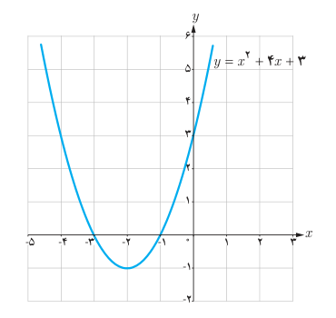
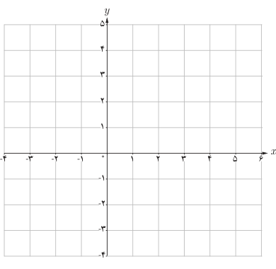

# صفرهای تابع

## فعالیت

نمودار تابع $f$ با ضابطه $f(x)=x^2+4x+3$ در شکل روبه‌رو رسم شده است.

۱. معادله $f(x)=0$ را حل کنید و جواب‌های آن را به‌دست آورید.

۲. محل تلاقی نمودار تابع $f$ با محور طول‌ها چه رابطه‌ای با جواب‌های معادله $f(x)=0$ دارد؟

### صفرهای تابع

برای هر تابع $f$ جواب‌های معادله $f(x)=0$ را (در صورت وجود) صفرهای تابع $f$ می‌نامیم. به عبارت دیگر، صفرهای تابع $f$ آن مقادیری از $x$ (در دامنه $f$) هستند که به ازای آنها $f(x)$ برابر صفر می‌شود. اگر نمودار $f(x)$ را رسم کنیم صفرهای $f$ طول نقاط تلاقی نمودار با محور $x$هاست.

## کار در کلاس

۱. نمودار سهمی‌های $f(x)=x^2-2x+1$ و $g(x)=x^2+1$ را رسم کنید.

۲. با توجه به نمودارهایی که رسم کردید در مورد جواب‌های معادله‌های $f(x)=0$ و $g(x)=0$ چه می‌توان گفت؟
