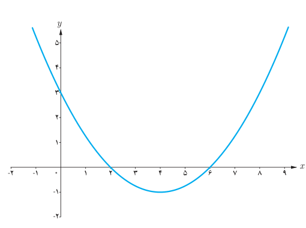

# فصل اول: جبر و معادله — ۱۱

**مثال:** اگر $x'$ و $x''$ صفرهای تابع درجه دوم $f(x)=ax^2+bx+c$ باشند نشان دهید:

$$ax^2+bx+c=a(x-x')(x-x'')$$

**حل:** از آنجا که $x'$ و $x''$ صفرهای تابع $f(x)=ax^2+bx+c$ هستند پس جواب‌های معادله $ax^2+bx+c=0$ هستند و داریم:

$$\begin{aligned}a(x-x')(x-x'')&=a(x^2-(x'+x'')x+x'x'')\\&=a(x^2-Sx+p)\\&=a\left[x^2-\left(\frac{-b}{a}\right)x+\frac ca\right]\\&=ax^2+bx+c\end{aligned}$$

**مثال:** اگر نمودار سهمی $y=ax^2+bx+c$ به‌صورت زیر باشد ضابطه سهمی را مشخص کنید.

**روش اول:** از آنجا که $x'=2$ و $x''=6$ صفرهای تابع $f(x)=ax^2+bx+c$ هستند با استفاده از رابطه‌ای که در مثال قبل آمده است می‌توان نوشت:

$$f(x)=ax^2+bx+c=a(x-2)(x-6)$$

می‌دانیم نمودار تابع از نقطه $(0,3)$ می‌گذرد پس مختصات این نقطه در ضابطه تابع صدق می‌کند و داریم:

$$3=a(0-2)(0-6)\Rightarrow a=\frac14$$

معادله سهمی به‌صورت $y=\frac14(x-2)(x-6)$ می‌باشد که پس از ساده‌سازی به‌صورت $y=\frac14x^2-2x+3$ نوشته می‌شود.

**روش دوم:** از آنجا که $f(0)=3$ می‌توان نوشت $f(x)=ax^2+bx+3$؛ حال از روابط بین صفرهای تابع استفاده می‌کنیم.

$$\frac ca=12\Rightarrow\frac3a=12\Rightarrow a=\frac14$$

از طرفی از آنجا که $\frac{-b}{a}=8$ و $a=\frac14$ پس $b=-2$ و در نتیجه $y=\frac14x^2-2x+3$.
