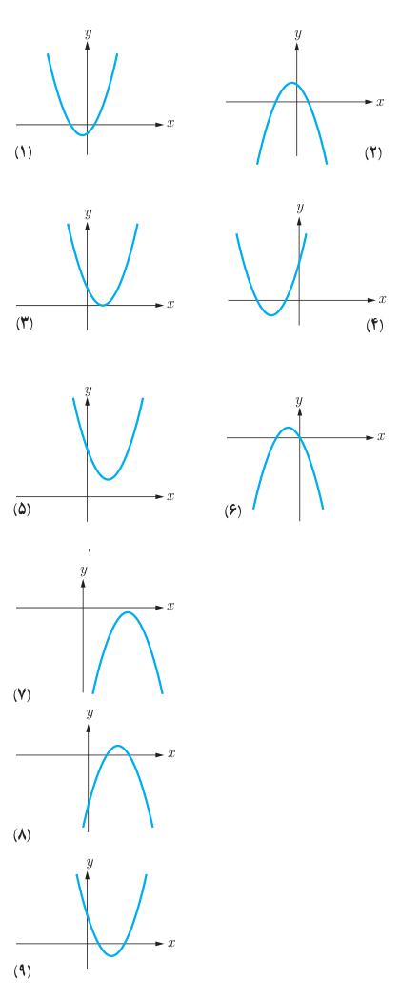

# صفحهٔ ۱۲

## کار در کلاس

هر یک از شکل‌های زیر نمودار یک سهمی به معادله کلی $f(x)=ax^2+bx+c$ است.

۱. با توجه به معادله $f(x)=0$ نمودار یا نمودارهای متناظر با هر یک از ویژگی‌های زیر را مشخص کنید.

الف) دو ریشه متمایز مثبت دارد. (شکل‌های ۸ و ۹)

ب) دو ریشه منفی دارد. (　　　)

پ) یک ریشه مثبت و یک ریشه منفی دارد. (　　　)

ت) ریشه ندارد. (　　　)

ث) ریشه ندارد و دارای ماکزیمم است. (　　　)

ج) یک ریشه مضاعف دارد. (　　　)

چ) حاصل جمع ریشه‌های متمایز مثبت است. (　　　)

ح) حاصل جمع ریشه‌ها منفی است. (　　　)

۲. با توجه به نمودارهای داده شده مقابل، جدول زیر را مانند نمونه کامل کنید.

| ویژگی / شماره شکل | ۱ | ۲ | ۳ | ۴ | ۵ | ۶ | ۷ | ۸ | ۹ |
|---|---|---|---|---|---|---|---|---|---|
| تعداد صفر $f$ | ۲ | | | | ۰ | | | | |
| علامت $a$ | + | | | | + | | | − | |
| علامت $b$ | + | | | | − | − | | | |
| علامت $c$ | − | | | | + | | − | | |

**تذکر:** ستون نظیر شکل پنجم را با توجه به استدلال زیر کامل کرده‌ایم. از آنجا که منحنی سهمی محور $x$ها را قطع نکرده است پس تعداد صفرهای تابع متناظر آن صفر خواهد بود؛ و چون شاخه‌های منحنی به سمت بالا هستند علامت $a$ مثبت است. از آنجا که منحنی، محور $y$ها را در نقطه با عرض مثبت قطع می‌کند پس $c>0$ و طول نقطه مینیمم تابع، مقداری مثبت است. پس $\frac{-b}{2a}>0$ و از مثبت بودن $a$ و رابطه اخیر نتیجه می‌شود $b<0$.
