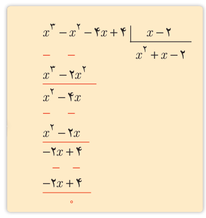

# فصل اول: جبر و معادله — ۱۳

**مثال:** اگر $x=2$ یکی از صفرهای تابع $p(x)=x^3-x^2-4x+4$ باشد سایر صفرهای تابع را در صورت وجود بیابید.

**حل:** از آنجا که $x=2$ یک صفر تابع $p(x)$ است می‌توان نشان داد که $p(x)$ عاملی به‌صورت $x-2$ دارد، پس با تقسیم $p(x)$ بر $x-2$ عامل دیگر $p(x)$ را می‌یابیم.

می‌توان نوشت $p(x)=(x-2)(x^2+x-2)$. آنگاه از حل معادله $p(x)=0$ داریم:

$$\begin{cases}x-2=0\Rightarrow x=2\\x^2+x-2=0\Rightarrow\begin{cases}x=-2\\x=1\end{cases}\end{cases}$$

صفرهای تابع $p$ برابر ۲، ۲-، ۱ می‌باشند.

## کار در کلاس

مقدار $k$ را چنان بیابید که یکی از صفرهای تابع $f(x)=x^3+kx^2-x-2$ برابر $-2$ باشد، سپس صفرهای دیگر تابع را به‌دست آورید.

**مثال:** صفرهای تابع $f$ با ضابطه $f(x)=(x^2-1)^2+(x^2-1)-2$ را به‌دست آورید.

**حل:** هر چند معادله $f(x)=0$ از درجه چهار است اما می‌توان با یک تغییر متغیر مناسب آن را به یک معادله درجه دوم تبدیل کرد. با فرض $t=x^2-1$، معادله به‌صورت $t^2+t-2=0$ در می‌آید. اکنون با حل این معادله و یافتن $t$ با استفاده از عبارت $t=x^2-1$ مقادیر $x$ را می‌یابیم.

$$t^2+t-2=0\Rightarrow t=1\quad\text{یا}\quad t=-2$$
$$\begin{cases}t=1\Rightarrow x^2-1=1\Rightarrow x=\pm\sqrt2\\t=-2\Rightarrow x^2-1=-2\Rightarrow x^2=-1\quad\text{غیرقابل قبول}\end{cases}$$

پس تنها صفرهای قابل قبول برای تابع $f$، $\sqrt2$ و $-\sqrt2$ می‌باشد.

برخی از معادلات را می‌توان با یک تغییر متغیر مناسب، به یکی از انواع معادلاتی که می‌شناسیم تبدیل کرد و پس از حل آن و با رجوع به تغییر متغیر، مقادیر مجهول اصلی معادله اولیه را یافت.

## کار در کلاس

همه صفرهای تابع $f(x)=x^4-10x^2+16$ را به‌دست آورید.
