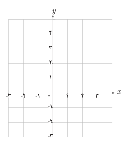
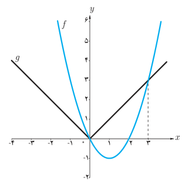

# روش هندسی حل معادلات

## فعالیت

۱. معادله $(x-1)^2=\frac12x+1$ را حل کنید.

۲. نمودار دو تابع $y=(x-1)^2$ و $y=\frac12x+1$ را رسم کنید.

۳. چه ارتباطی بین ریشه‌های معادله $(x-1)^2=\frac12x+1$ و طول‌های نقاط تلاقی نمودارها وجود دارد؟

اگر $f(x)$ و $g(x)$ دو تابع باشند، طول نقاط تلاقی نمودارهای این دو تابع جواب‌های معادله $f(x)=g(x)$ است و برعکس، هر جواب این معادله طول یکی از نقاط تلاقی این دو نمودار است.

این روش حل معادله را، که از طریق آن تعداد جواب‌ها و مقدار تقریبی (و گاهی دقیق) جواب‌ها قابل تشخیص است، **روش هندسی (نموداری) حل معادلات** می‌نامیم.

**مثال:** به روش هندسی معادله $|x|=x^2-2x$ را حل کنید.

**حل:** با فرض $f(x)=x^2-2x$ و $g(x)=|x|$، نمودار این دو تابع را رسم می‌کنیم:

با توجه به نمودارهای دو تابع طول نقاط تلاقی دو نمودار عبارت‌اند از: $x=0$، $x=3$ که جواب‌های معادله $|x|=x^2-2x$ می‌باشند.
