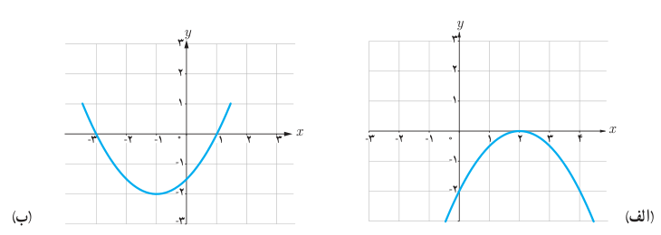
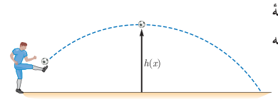

# فصل اول: جبر و معادله — ۱۵

## تمرین

۱. معادله درجه دومی بنویسید که:

الف) ریشه‌های آن $\frac13$ و $\frac23$ باشند.

ب) یکی از ریشه‌های آن دو برابر دیگری باشد (مسئله چند جواب دارد؟).

۲. در هر یک از شکل‌های زیر نمودار سهمی $P(x)=ax^2+bx+c$ داده شده است. در هر حالت صفرهای تابع $P(x)$ و ضابطه آن را مشخص کنید.

۳. یک توپ فوتبال بر اثر ضربه بازیکن طبق شکل روبه‌رو حرکت می‌کند تا دوباره به زمین بخورد. در هر لحظه ارتفاع توپ از سطح زمین را می‌توانیم با رابطه $h(x)=-0.03x(x-36)$ مدل‌سازی کنیم که $x$ فاصله افقی توپ از نقطه اولیه است ($x$ برحسب متر است).

الف) توپ چند متر افقی را طی می‌کند تا دوباره به زمین بخورد؟

ب) توپ حداکثر تا چه ارتفاعی بالا می‌رود؟

۴. صفرهای توابع زیر را در صورت وجود به‌دست آورید.

الف) $f(x)=x^2-4x$  
ب) $g(x)=2x^3+x^2+3x$  
پ) $h(x)=x^4+3x^2+5$

۵. معادلات زیر را حل کنید.

الف) $x^4-3x^2-4=0$  
ب) $(\frac{x^2}{3}-2)^2-7(\frac{x^2}{3}-2)+6=0$  
پ) $(4-x^2)^2-(4-x^2)=12$
