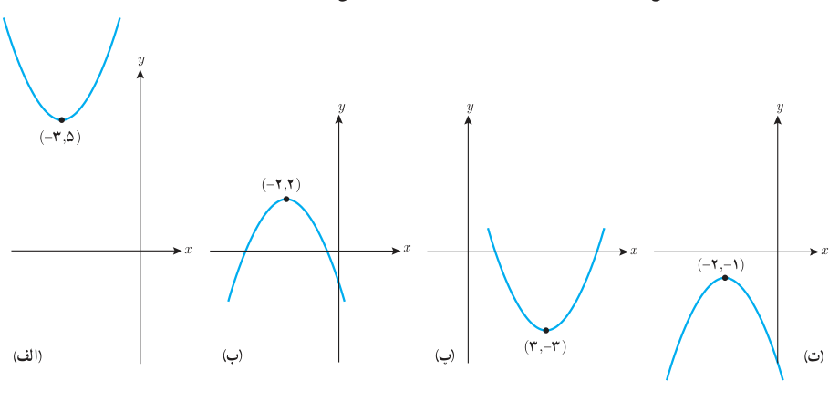
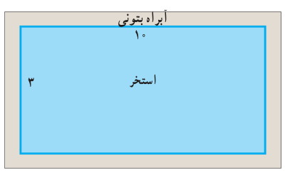

# صفحهٔ ۱۶

۶. تعداد و مقدار تقریبی ریشه‌های معادله $|x-1|=x^2-x-1$ را با استفاده از روش هندسی به‌دست آورید.

۷. هر یک از سهمی‌های زیر نمودار حالتی از تابع $f(x)=ax^2+bx+c$ است که در آن $|a|=1$ است و نقطه رأس سهمی نیز داده شده است. صفرهای تابع را در صورت وجود به‌دست آورید و ضابطه تابع را مشخص کنید.

۸. یک استخر مستطیل شکل به ابعاد طول ۱۰ و عرض ۳ متر داریم که یک آبراه بتونی در اطرافش است. اگر این آبراه دارای پهنای یکسان و مساحت ۱۴ مترمربع باشد، پهنای آن را محاسبه کنید.

۹. طول یک نوع کاشی یک سانتی‌متر بلندتر از چهار برابر عرض آن است. برای پوشانیدن دیواری به مساحت ۵۲٫۸ مترمربع تعداد دو هزار کاشی مصرف شده است. طول هر کاشی چند سانتی‌متر است؟
