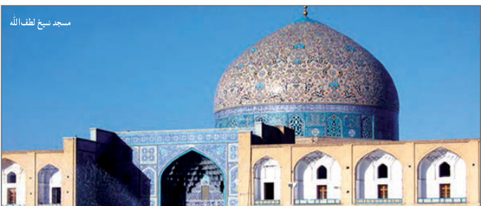

# فصل اول: جبر و معادله — ۱۹

## کار در کلاس

۱. معادله $\frac1{(x-2)^2}+\frac2{x-2}=3$ را حل کنید.

۲. اگر در یک مستطیل با طول $L$ و عرض $w$ داشته باشیم:

$$\frac Lw=\frac{w+L}{L}$$

آنگاه می‌گوییم در این مستطیل نسبت طلایی برقرار است.

اگر محیط یک زمین ورزشی مستطیل شکل، برابر ۱۴۴ متر و اندازه طول و عرض آن متناسب با نسبت طلایی باشد، طول و عرض زمین چقدر است؟

## خواندنی

در ریاضیات هنگامی نسبت طلایی پدید می‌آید که نسبت بخش بزرگ‌تر به بخش کوچک‌تر برابر نسبت مجموع دو بخش به بخش بزرگ‌تر باشد.

مصریان سال‌ها قبل از میلاد از این نسبت آگاه بودند و آن را در ساخت اهرام رعایت کرده‌اند. بسیاری از الگوهای طبیعی در بدن انسان نیز این نسبت را دارا هستند. روان‌شناسان بر این باورند که زیباترین مستطیل به چشم انسان مستطیلی است که نسبت طول به عرض آن برابر عدد طلایی باشد. دلیل این امر آن است که این نسبت در شبکه چشم انسان رعایت شده و هر مستطیلی که این نسبت را دارا باشد به چشم زیبا می‌آید.

در ساخت برج میدان آزادی تهران به ارتفاع ۴۵ و عرض ۴۲ متر نسبت طلایی تا حد زیادی رعایت شده است. کتیبه بیستون از دوره هخامنشی در کرمانشاه به طول ۵ و عرض ۳ متر به عدد طلایی نزدیک است. یکی از هنرهای معماری در تخت جمشید این است که ارتفاع سردرها به عرض آنها و همین‌طور نسبت ارتفاع ستون‌ها به فاصله بین دو ستون نسبت طلایی است.

در پل ورسک، ارگ بم، مقبره ابن‌سینا، میدان نقش جهان، مسجد شیخ لطف‌الله و خوشنویسی میرعماد حسنی از نسبت طلایی استفاده شده است. با جست‌وجوی اینترنتی به مطالب خواندنی در این زمینه دست می‌یابید.

منبع: مبانی هنرهای تجسمی، قسمت اول، شرکت چاپ و نشر کتاب‌های درسی ایران، ۱۳۸۲

