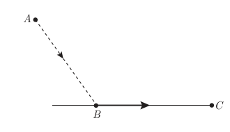
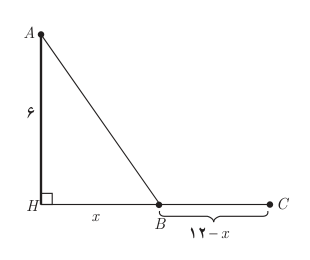

# معادلات شامل عبارت‌های گنگ

## طرح یک مسئله

معمولاً مرغ‌های دریایی، برای شکار ماهی‌ها، بخشی از مسیر خود را در هوا و بخشی را به موازات سطح آب طی می‌کنند. یک مرغ دریایی در نقطه $A$ به ارتفاع ۶ متر از سطح آب قرار دارد. فاصله تصویر مرغ روی آب از ماهی که در نقطه $C$ قرار دارد ۱۲ متر است. مرغ ابتدا از نقطه $A$ به نقطه $B$ می‌آید سپس در سطح آب از $B$ به $C$ می‌رود و ماهی را شکار می‌کند. اگر مرغ دریایی برای طی هر متر در هوا ۱۴ کیلوکالری و برای طی هر متر در سطح آب ۱۰ کیلوکالری انرژی مصرف کند، نقطه $B$ در چه فاصله‌ای از $C$ باید باشد تا مرغ دریایی روی هم ۱۸۰ کیلوکالری انرژی مصرف کند؟

**حل:** برای درک بهتر صورت مسئله شکل روبه‌رو را رسم می‌کنیم. فاصله $B$ از تصویر مرغ بر روی آب $(H)$ را $x$ می‌گیریم در نتیجه فاصله میان $B$ و $C$ برابر $12-x$ می‌شود. با استفاده از رابطه فیثاغورس طول $AB$ برابر $\sqrt{36+x^2}$ می‌شود.

میزان انرژی مصرف‌شده توسط مرغ دریایی برابر است با:

$$14\sqrt{36+x^2}+10(12-x)$$

برای آنکه مرغ دریایی روی هم ۱۸۰ کیلوکالری انرژی مصرف کند باید داشته باشیم:

$$14\sqrt{36+x^2}+120-10x=180\Rightarrow14\sqrt{36+x^2}=10x+60$$
$$7\sqrt{36+x^2}=5x+30$$

با به توان دو رساندن طرفین معادله اخیر و ساده کردن به معادله درجه دوم $2x^2-25x+72=0$ می‌رسیم که از آنجا $x=8$ یا $x=4.5$. در این صورت فاصله $B$ تا $C$ برابر $12-8=4$ یا $12-4.5=7.5$ خواهد بود.

اگر مرغ دریایی مستقیماً از $A$ به $C$ پرواز می‌کرد چقدر کالری مصرف می‌کرد؟

آیا اقدام مرغ دریایی برای شکار ماهی‌ها هوشمندانه نمی‌باشد؟!
