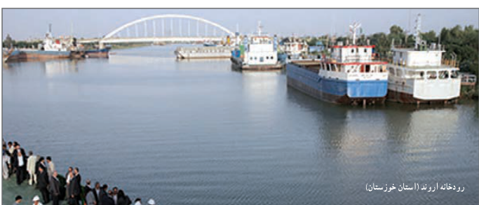

# تمرین — صفحهٔ ۲۲

معادلات زیر را حل کنید.

۱. $\frac6x=2+\frac{x-3}{x+1}$

۲. $\frac P{2-P}+\frac2P=\frac{-3}{2}$

۳. $\frac{3y+5}{y^2+5y}+\frac{y+4}{y+5}=\frac{y+1}{y}$

۴. $2\sqrt{x}=\sqrt{3x+4}$

۵. $\frac{1-\sqrt{x}}{1+\sqrt{x}}=1-x$

۶. $\frac5{\sqrt{x}+2}=2-\frac1{\sqrt{x}-2}$

۷. $\sqrt{x+3}+\sqrt{3x+1}=4$

۸. پدربزرگ برای اهدا به مهدکودک چند اسباب‌بازی یکسان، مجموعاً به قیمت ۱۲۰ هزار تومان خرید. اگر فروشنده برای هر اسباب‌بازی هزار تومان به پدربزرگ تخفیف می‌داد او می‌توانست با همان پول چهار اسباب‌بازی دیگر هم بخرد. قیمت هر اسباب‌بازی قبل از تخفیف چقدر بوده است؟

۹. ماشین $A$ کاری را به‌تنهایی ۱۵ ساعت زودتر از ماشین $B$ انجام می‌دهد. اگر هر دو ماشین یک کار را در ۱۸ ساعت انجام دهند، چه زمانی برای هر کدام از ماشین‌ها لازم است تا آن کار را به تنهایی انجام دهند؟

۱۰. فاصله بین دو شهر که در کنار رودخانه‌ای واقع شده‌اند ۱۴۴ کیلومتر است. یک کشتی از شهر اول به شهر دوم می‌رود و پس از دو ساعت توقف همین مسیر را برمی‌گردد. مدت زمان سفر در مجموع ۱۷ ساعت می‌باشد. در صورتی که سرعت حرکت کشتی در مسیر جریان آب ۸ کیلومتر در ساعت بیشتر از سرعت آن در خلاف جریان آب باشد سرعت حرکت کشتی را در جهت حرکت آب تعیین کنید.

رودخانه اروند (استان خوزستان)
