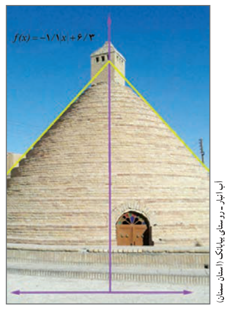

# درس ۴: قدر مطلق و ویژگی‌های آن

در سال قبل با مفهوم قدر مطلق و برخی از ویژگی‌های آن آشنا شدید. همان‌طور که می‌دانید قدر مطلق عدد حقیقی $a$ به‌صورت زیر تعریف می‌شود.

$$|a|=\begin{cases}a& a\ge0\\-a& a<0\end{cases}$$

## کار در کلاس

۱. حاصل هر یک از عبارت‌های زیر را بدون قدر مطلق بنویسید.

الف) $|-5-(-3)|=$　　 ب) $|\sqrt3-\sqrt5|=$　　 پ) $|1.5-1\frac12|=$

۲. عبارت‌های زیر را به ساده‌ترین صورت ممکن بنویسید.

الف) $\sqrt{a^4+2a^2+1}=\sqrt{(\ldots+\ldots)^2}=\ldots$

ب) $\sqrt{7-4\sqrt3}=\sqrt{(\sqrt3-\ldots)^2}=$

آب انبار ـ روستای پاده (استان سمنان)
