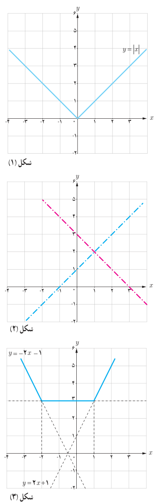
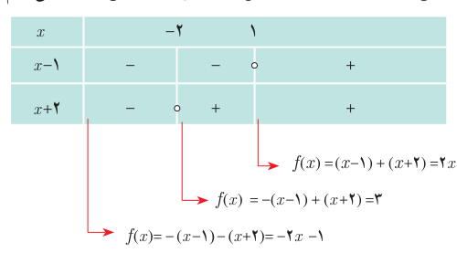

# رسم توابع قدر مطلقی

## فعالیت

می‌خواهیم نمودار تابع $y=|x-1|+2$ را رسم کنیم.

**روش اول:** با توجه به نمودار $y=|x|$ در شکل (۱) و استفاده از انتقال منحنی، نمودار آن را رسم کنید.

**روش دوم:** گام اول: با استفاده از تعیین علامت، تابع را به‌صورت یک تابع دو ضابطه‌ای بنویسید.

$$y=|x-1|+2=\begin{cases}\qquad&x\ge1\\\qquad&x<1\end{cases}$$

گام دوم: با توجه به شکل (۲) نمودار $y$ را رسم کنید.

**مثال:** نمودار تابع $f$ با ضابطه $f(x)=|x-1|+|x+2|$ را رسم کنید.

**حل:** در اینجا نمی‌توانیم از رسم تابع $y=|x|$ و انتقال استفاده کنیم. بنابراین از روش تعیین علامت عبارت‌های داخل قدر مطلق‌ها کمک می‌گیریم. برای این کار ابتدا عبارت‌های داخل قدر مطلق‌ها را تعیین علامت می‌کنیم.

$$f(x)=\begin{cases}-2x-1&x<-2\\3&-2\le x\le1\\2x+1&x>1\end{cases}$$

نمودار تابع از سه قسمت که هر یک بخشی از یک خط هستند تشکیل می‌شود (شکل ۳).
