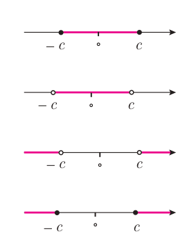

# ویژگی‌های قدر مطلق — صفحهٔ ۲۵

در سال‌های قبل با برخی از ویژگی‌های قدر مطلق آشنا شده‌اید که عبارت‌اند از:

الف) $|x|\ge0$  
ب) $\sqrt{x^2}=|x|$  
پ) $|x|=a\Leftrightarrow x=a$ یا $x=-a$، $(a\ge0)$  
ت) $|x|=|a|\Leftrightarrow x=a$ یا $x=-a$  
ث) $|-x|=|x|$  
ج) $|x|^2=x^2$

## فعالیت

فرض کنید $a$ و $b$ عددهای حقیقی دلخواه باشند.

۱. از رابطه $\sqrt{a^2}=|a|$ استفاده کنید و نشان دهید که: $|ab|=|a||b|$

۲. با فرض $b\ne0$ و استفاده از مرحله قبل ثابت کنید که: $\left|\frac ab\right|=\frac{|a|}{|b|}$

## فعالیت

۱. فرض کنید $c$ یک عدد حقیقی نامنفی باشد. هر یک از نامعادله‌های زیر را به جواب متناظر آن وصل کنید.

الف) $|x|<c$، $(c\ne0)$  
ب) $|x|>c$  
پ) $|x|\le c$  
ت) $|x|\ge c$

۲. برای هر عدد حقیقی $a$ نشان دهید که: $-|a|\le a\le|a|$

۳. برای هر دو عدد حقیقی $a$ و $b$ ثابت کنید که: $-|a|-|b|\le a+b\le|a|+|b|$

۴. با استفاده از قسمت قبل «نامساوی مثلث» را برای هر دو عدد حقیقی $a$ و $b$ نتیجه بگیرید: $|a+b|\le|a|+|b|$
