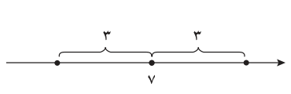
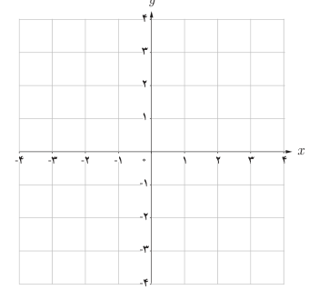

# معادلات قدر مطلقی

## حل یک مسئله

بر روی محور اعداد حقیقی فاصله چه نقاطی از نقطه ثابت ۷ برابر ۳ است؟

برای حل مسئله شکل روبه‌رو را رسم می‌کنیم.

اگر طول نقطه جواب مسئله را $x$ بنامیم، شرط مسئله به این معناست که $|x-7|=3$. با استفاده از ویژگی‌های قدر مطلق خواهیم دانست $x-7=\pm3$، و در نتیجه $x=10$ و $x=4$؛ و هر دو جواب‌های معادله هستند.

جواب‌های معادله $|f(x)|=|g(x)|$ همان جواب‌های دو معادله $f(x)=g(x)$ و $f(x)=-g(x)$ هستند. به معادلاتی نظیر این معادلات که شامل عبارت قدر مطلق هستند **معادلات قدر مطلقی** می‌گویند.

**مثال:** معادله $|3x-2|=|x-4|$ را حل کنید.

**روش اول:** با استفاده از ویژگی‌های قدر مطلق: جواب‌های این معادله همان جواب‌های دو معادله $3x-2=x-4$ و $3x-2=-(x-4)$ هستند که، به‌ترتیب، عبارت‌اند از: $x=-1$ و $x=\frac32$.

**روش دوم:** با به توان دو رساندن طرفین معادله خواهیم داشت: $9x^2-12x+4=x^2-8x+16$؛ و از آنجا $2x^2-x-3=0$. جواب‌های این معادله ۱- و $\frac32$ هستند.

## کار در کلاس

معادله قدر مطلقی $|x-1|=4-3x$ را به سه روش زیر حل کنید.

۱. روش اول: (با استفاده از تعریف قدر مطلق)

$$|x-1|=\begin{cases}\ldots&x\ge1\\\ldots&x<1\end{cases}$$

حالت اول: $x\ge1\Rightarrow x-1=4-3x\Rightarrow x=\frac54$، حالت دوم: $x<1\Rightarrow\ldots$، مجموعه جواب = {　　　}

۲. روش دوم: (روش هندسی)

الف) توابع $y=|x-1|$ و $y=4-3x$ را رسم کنید.

ب) طول‌های محل تلاقی دو نمودار را مشخص کنید.

پ) جواب‌های معادله را به‌دست آورید.

۳. روش سوم: (به توان رساندن طرفین)
