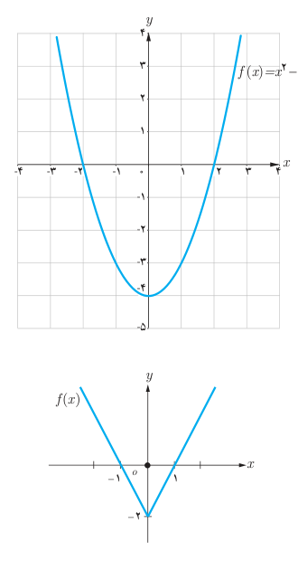
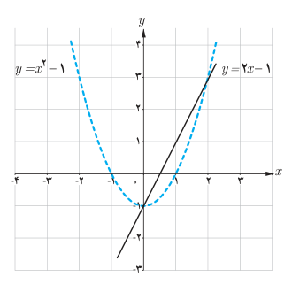

# فصل اول: جبر و معادله — ۲۷

## فعالیت

در شکل روبه‌رو نمودار تابعی با ضابطه $f(x)=x^2-4$ آمده است.

۱. با توجه به علامت عبارت $x^2-4$ و استفاده از تعریف قدر مطلق، تابع $y=|x^2-4|$ را به‌صورت چندضابطه‌ای بنویسید.

۲. نمودار $y=|x^2-4|$ را رسم کنید.

۳. تابع $y=|f(x)|$ را به‌صورت یک تابع دوضابطه‌ای بنویسید.

$$y=|f(x)|=\begin{cases}\qquad&f(x)\ge0\\\qquad&f(x)<0\end{cases}$$

۴. با توجه به قسمت‌های قبل یک روش رسم برای تابع $y=|f(x)|$ از روی نمودار $y=f(x)$ بیان کنید.

۵. در شکل روبه‌رو نمودار تابع با ضابطه $y=|f(x)|$ را از روی نمودار تابع $y=f(x)$ رسم کنید.

با توجه به فعالیت بالا:

۱. نمودار $y=-f(x)$ قرینه نمودار $y=f(x)$ نسبت به محور $x$هاست.

۲. برای رسم نمودار $y=|f(x)|$ کافی است نمودار $y=f(x)$ را رسم کنیم و در جاهایی که نمودار $f(x)$ زیر محور $x$هاست، تصویر آینه‌وار نمودار $f(x)$ را نسبت به محور $x$ها رسم کنیم.

## کار در کلاس

۱. با استفاده از شکل روبه‌رو، نمودار توابع $y=|2x-1|$ و $y=|x^2-1|$ را رسم کنید و تعداد جواب‌های معادله $|x^2-1|=|2x-1|$ و مقدار تقریبی جواب‌ها را به‌دست آورید.

۲. به روش جبری و با استفاده از ویژگی‌های قدر مطلق معادله $|x^2-1|=|2x-1|$ را حل کنید.

حالت اول: $x^2-1=2x-1\Rightarrow x^2-2x=0\Rightarrow x=0$ یا $x=2$

حالت دوم: $x^2-1=-(2x-1)\Rightarrow\ldots$
