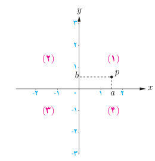
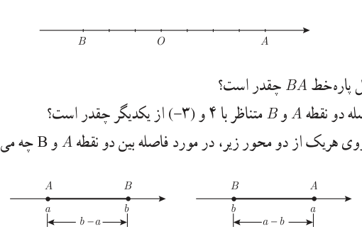

# درس ۵: آشنایی با هندسه تحلیلی

در سال‌های گذشته با دستگاه محورهای مختصات آشنا شده‌اید. محورهای مختصات، صفحه را به چهار ناحیه تقسیم می‌کنند که هر ناحیه یک ربع نامیده می‌شود. نقاط روی محورها در هیچ ربعی نیستند.

به هر نقطه $P$ در صفحه مختصات یک زوج مرتب $(a,b)$ نظیر می‌شود. به این زوج مختصات نقطه $P$ گفته می‌شود. طول نقطه $P$ را با $x_p$ و عرض آن را با $y_p$ نشان می‌دهیم. در این درس با برخی از ویژگی‌های نقطه در صفحه مختصات آشنا می‌شویم.

## فاصله بین دو نقطه

### فعالیت

روی محور اعداد زیر به مبدأ $O$، نقطه متناظر ۴ را با $A$ و نقطه متناظر ۳- را با $B$ مشخص کرده‌ایم:

۱. طول پاره‌خط‌های $OA$ و $OB$ چقدر است؟

۲. طول پاره‌خط $BA$ چقدر است؟

۳. فاصله دو نقطه $A$ و $B$ متناظر با ۴ و ۳- از یکدیگر چقدر است؟

۴. بر روی هر یک از دو محور زیر، در مورد فاصله بین دو نقطه $A$ و $B$ چه می‌توان گفت؟

اگر طول نقاط متناظر با $A$ و $B$ روی محور اعداد را به‌ترتیب با $x_A$ و $x_B$ نشان دهیم، در این صورت فاصله بین $A$ و $B$ را به‌صورت $|AB|=|x_B-x_A|$ تعریف می‌کنیم.

## خواندنی

هندسه تحلیلی شاخه‌ای از ریاضیات است که از ترکیب هندسه و جبر مقدماتی به‌وجود آمده است. در این رشته اشکال هندسی و روابط بین آنها را با مقادیر و معادلات عددی و جبری بیان می‌کنند. بنیان‌گذاران هندسه تحلیلی دکارت و فرما در قرن ۱۷ میلادی بوده‌اند. این رشته در مورد اندازه، فاصله، زاویه و فرمول‌های مربوط به آن بحث می‌کند.
