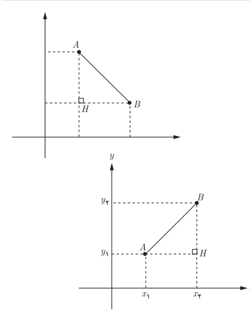
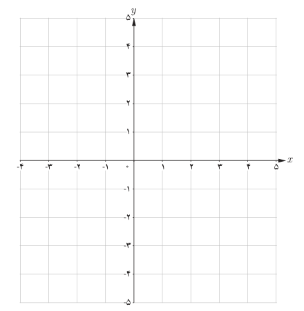

# صفحهٔ ۳۰

## فعالیت

۱. دو نقطه $A(2,5)$ و $B(6,3)$ را، در شکل روبه‌رو، در نظر بگیرید:

الف) روی محور افقی $x_A$ و $x_B$ و روی محور عمودی $y_A$ و $y_B$ را مشخص کنید.

ب) در مثلث قائم‌الزاویه $AHB$ ($\widehat H=90^\circ$) با استفاده از رابطه فیثاغورس، طول پاره‌خط $AB$ را به‌دست آورید.

۲. در شکل روبه‌رو، اگر $A(x_1,y_1)$ و $B(x_2,y_2)$ دو نقطه دلخواه در صفحه مختصات باشند، طول $AB$ را محاسبه کنید.

$$AB^2=AH^2+BH^2$$
$$AB^2=\ldots$$
$$AB=\sqrt{\ldots}$$

به‌طور کلی، اگر در صفحه مختصات دو نقطه $A(x_1,y_1)$ و $B(x_2,y_2)$ را داشته باشیم، طول پاره‌خط $AB$ برابر است با:

$$AB=\sqrt{(x_2-x_1)^2+(y_2-y_1)^2}$$

## کار در کلاس

سه نقطه $A(1,3)$، $B(-1,2)$ و $C(5,-5)$ سه رأس مثلث $ABC$، در صفحه مختصات روبه‌رو، هستند.

الف) مثلث را رسم کنید.

ب) طول اضلاع مثلث را به‌دست آورید.

پ) نشان دهید مثلث $ABC$ قائم‌الزاویه است.

ت) شیب دو خط $AB$ و $AC$ را به‌دست آورید. چه رابطه‌ای بین دو شیب مشاهده می‌کنید؟
