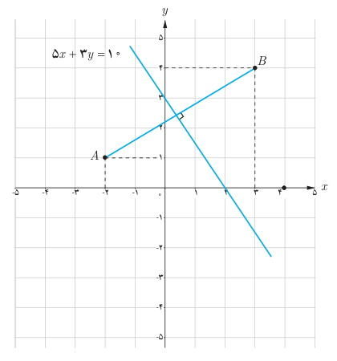

# فصل اول: جبر و معادله — ۳۱

**مثال:** در شکل زیر، معادله عمودمنصف پاره‌خطی را بنویسید که دو نقطه $A(-2,1)$ و $B(3,4)$ را به هم وصل کرده است.

**حل:** عمودمنصف یک پاره‌خط شامل همه نقاطی است که فاصله آنها از دو سر پاره‌خط به یک اندازه است. بنابراین اگر $PA=PB$ آنگاه $P$ روی عمودمنصف $AB$ قرار دارد. فرض کنیم $P(x,y)$ آنگاه با استفاده از فرمول فاصله پاره‌خط می‌توان نوشت:

$$\sqrt{(x+2)^2+(y-1)^2}=\sqrt{(x-3)^2+(y-4)^2}$$

با به توان دو رساندن طرفین و ساده کردن داریم:

$$5x+3y=10$$

این معادله برای تمام نقاطی که از $A$ و $B$ هم‌فاصله‌اند برقرار است، بنابراین، معادله عمودمنصف $AB$ است.

در مثال بالا شیب خط $AB$ برابر $\frac35$ و شیب خط عمودمنصف آن برابر $-\frac53$ است. چه رابطه‌ای بین این دو شیب مشاهده می‌شود؟

به‌طور کلی: اگر خطوط $d$ و $d'$ به‌ترتیب با شیب‌های $m$ و $m'$ بر هم عمود باشند آنگاه $mm'=-1$ و برعکس.

## کار در کلاس

نشان دهید نقطه $P(-12,11)$ روی عمودمنصف پاره‌خط واصل دو نقطه $A(0,-3)$ و $B(6,15)$ قرار دارد.
