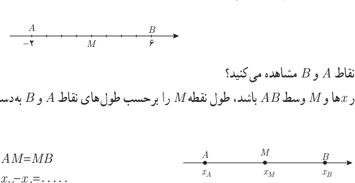
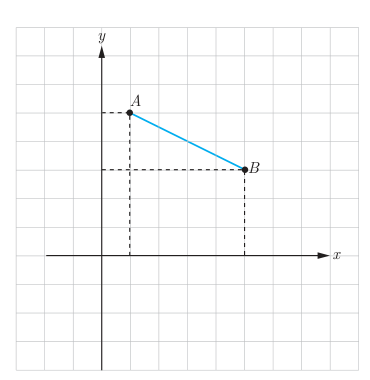

# مختصات نقطه وسط یک پاره‌خط — صفحهٔ ۳۲

## فعالیت

۱. در شکل زیر نقطه $M$ وسط پاره‌خط $AB$ است. طول نقطه $M$ چقدر است؟

۲. چه ارتباطی بین طول نقطه $M$ و طول نقاط $A$ و $B$ مشاهده می‌کنید؟

۳. اگر $A$ و $B$ دو نقطه دلخواه روی محور $x$ها و $M$ وسط $AB$ باشد، طول نقطه $M$ را برحسب طول‌های نقاط $A$ و $B$ به‌دست آورید.

$$AM=MB$$
$$x_M-x_A=\ldots$$

۴. اگر $A$ و $B$ روی محور $y$ها و عرض نقاط $A$ و $B$ را با $y_A$ و $y_B$ نشان دهیم و $M$ وسط پاره‌خط $AB$ باشد، چه دستوری برای محاسبه عرض نقطه $M$ می‌توان بیان کرد؟

## کار در کلاس

اگر $A(1,5)$ و $B(5,3)$ دو سر پاره‌خط $AB$ و $M(a,b)$ وسط این پاره‌خط باشد:

الف) تصویر نقاط $A$ و $B$ و $M$ را روی محورهای مختصات مشخص کنید.

ب) با توجه به تصویر نقاط $A$ و $B$ و $M$ روی محورهای مختصات نقطه $M$ را به‌دست آورید.

اگر $A$ و $B$ دو نقطه در صفحه مختصات و $M$ وسط پاره‌خط $AB$ باشد، مختصات نقطه $M$ برابر است با:

$$x_M=\frac{x_A+x_B}{2},\qquad y_M=\frac{y_A+y_B}{2}$$
