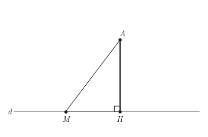
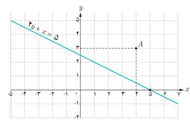

# فاصله یک نقطه از یک خط — صفحهٔ ۳۳

اگر خط $d$ و نقطه $A$ در خارج آن داده شده باشد، فاصله نقطه $A$ از خط $d$ را همان کوتاه‌ترین فاصله $A$ از $d$ تعریف می‌کنیم. با توجه به آنکه طول عمود از طول مایل کوتاه‌تر است (چرا؟) این فاصله را عمود $AH$ در نظر می‌گیریم.

بنابراین برای به‌دست آوردن فاصله هر نقطه از خط کافی است از آن نقطه بر خط عمودی رسم و طول پاره‌خط عمود شده را اندازه‌گیری کنیم.

## فعالیت

در شکل روبه‌رو خط $d$ به معادله $2y+x=5$ و نقطه $A(4,3)$ داده شده است.

۱. عمود $AH$ را بر خط $d$ رسم کنید.

۲. رابطه بین شیب‌های دو خط $d$ و $AH$ را به‌دست آورید.

۳. شیب $AH$ را به‌دست آورده و معادله خط $AH$ را بنویسید.

۴. دستگاه متشکل از دو خط $d$ و $AH$ را تشکیل دهید و مختصات محل برخورد دو خط (نقطه $H$) را به‌دست آورید.

۵. طول پاره‌خط $AH$ را محاسبه کنید.

به‌طور کلی اگر بخواهیم فاصله نقطه $A(x_0,y_0)$ از خط $ax+by+c=0$ را به‌دست آوریم، با استفاده از مراحل فعالیت قبل می‌توان نتیجه گرفت که طول عمود $AH$ برابر است با:

$$AH=\frac{|ax_0+by_0+c|}{\sqrt{a^2+b^2}}$$

که در آن، وجود علامت قدرمطلق در صورت کسر برای نامنفی شدن مقدار $AH$ می‌باشد.¹

۱- از اثبات فرمول به دلیل طولانی شدن صرف نظر می‌شود. دانش‌آموزان علاقه‌مند می‌توانند خود به اثبات آن بپردازند.
