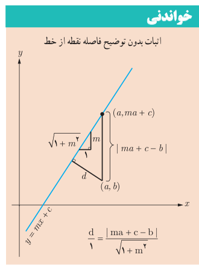

# صفحهٔ ۳۴

**مثال:** فاصله نقطه $A(-2,4)$ از خط $y=\frac43x+4$ را به‌دست آورید.

**حل:** ابتدا معادله خط را به‌صورت $4x-3y+12=0$ می‌نویسیم. طبق فرمول فاصله نقطه از خط، فاصله نقطه $A$ تا خط $d$ را $AH$ فرض می‌کنیم و داریم:

$$AH=\frac{|4(-2)-3(4)+12|}{\sqrt{4^2+(-3)^2}}=\frac{|-8|}{5}=\frac85$$

**مثال:** فاصله نقطه $A(1,-4)$ از خط $8x+6y=k$ برابر ۴ است. مقدار $k$ چقدر است؟

**حل:** ابتدا معادله خط را به‌صورت $8x+6y-k=0$ می‌نویسیم. مطابق فرمول فاصله نقطه از خط داریم:

$$AH=\frac{|8(1)+6(-4)-k|}{\sqrt{8^2+6^2}}\Rightarrow4=\frac{|-16-k|}{10}\Rightarrow|-16-k|=40$$
$$-16-k=40\Rightarrow k=-56$$
$$-16-k=-40\Rightarrow k=24$$

## خواندنی

اثبات بدون توضیح فاصله نقطه از خط

$$\frac d1=\frac{|ma+c-b|}{\sqrt{1+m^2}}$$

## کار در کلاس

۱. اگر نقطه $A(2,3)$ رأس یک مربع و معادله یک ضلع مربع $3x-4y=9$ باشد، مساحت مربع چقدر است؟

۲. دو خط $3x+2y=1$ و $2x-3y=2$ معادله‌های دو ضلع یک مستطیل‌اند و نقطه $A(2,5)$ یک رأس مستطیل است. مساحت مستطیل چقدر است؟
