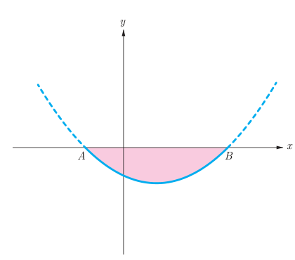

# تمرین — صفحهٔ ۳۵

۱. مثلث $ABC$ به رأس‌های $A(-1,7)$ و $B(-6,-2)$ و $C(3,3)$ را در نظر بگیرید.

الف) مثلث را رسم کنید.  
ب) نشان دهید مثلث متساوی‌الساقین است.  
پ) معادله عمودمنصف ضلع $BC$ را به‌دست آورید.  
ت) طول ارتفاع $AH$ چقدر است؟

۲. $A(0,6)$ و $B(8,-8)$ نقاط دو سر قطر یک دایره‌اند. مختصات مرکز و طول شعاع دایره را به‌دست آورید.

۳. شکل نمای جانبی عدسی از منحنی سهمی به معادله $y=x^2-8x-20$ مطابق شکل زیر مدل‌سازی می‌شود.

الف) مختصات نقاط انتهای عدسی $A$ و $B$ را به‌دست آورید.  
ب) اگر $x$ برحسب سانتی‌متر باشد طول $AB$ را به‌دست آورید.  
پ) اگر عدسی کاملاً متقارن و $y$ برحسب میلی‌متر باشد بیشترین ضخامت آن چقدر است؟

۴. ثابت کنید فاصله دو خط موازی $ax+by+c=0$ و $ax+by+c'=0$ برابر $\frac{|c-c'|}{\sqrt{a^2+b^2}}$ می‌باشد.

۵. خط $4x+3y=5$ بر دایره $C$ به مرکز $O(-1,2)$ مماس است. طول شعاع دایره چقدر است؟
