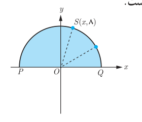

# صفحهٔ ۳۶

۶. نقطه $S(x,8)$ روی نیم‌دایره‌ای به شعاع ۱۰ در شکل روبه‌رو داده شده است.

الف) مقدار $x$ را به‌دست آورید.  
ب) شیب خط‌های $PS$ و $SQ$ را به‌دست آورید.  
پ) نشان دهید $\widehat{PSQ}$ قائمه است.

۷. اگر فاصله نقطه $A(1,2)$ از خط $ax+4y=1$ برابر ۲ باشد، مقدار $a$ چقدر است؟

۸. سه رأس مثلث $ABC$، $A(-11,-13)$، $B(-3,3)$ و $C(3,1)$ می‌باشند.

الف) طول عمودی را که از رأس $B$ بر میانه نظیر رأس $C$ وارد می‌شود به‌دست آورید.  
ب) مختصات رأس $D$ را چنان تعیین کنید که $ABCD$ یک متوازی‌الاضلاع باشد.

۹. نقطه‌ای روی خط $y=2x$ تعیین کنید که مجموع فاصله‌های آن تا مبدأ مختصات و نقطه $A(2,4)$ برابر ۵ باشد.

۱۰. نقاط $A(4,2)$ و $B(1,-1)$ و $C(8,-2)$ سه رأس مثلث $ABC$ هستند. اگر $H$ و $M$ به‌ترتیب پای ارتفاع $AH$ و میانه $AM$ باشند طول $MH$ را به‌دست آورید.
