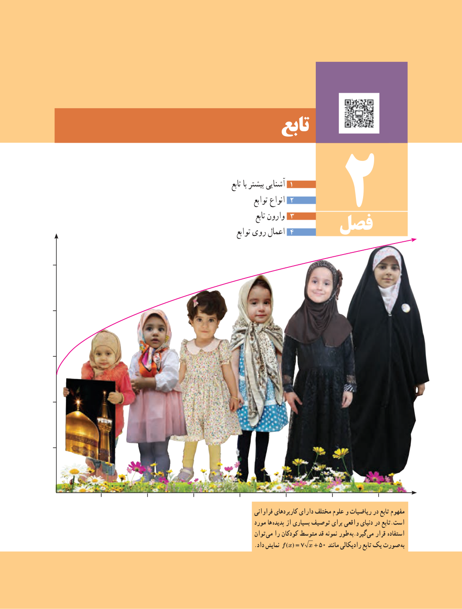

# فصل ۲: تابع

۱. آشنایی بیشتر با تابع  
۲. انواع توابع  
۳. وارون تابع  
۴. اعمال روی توابع

مفهوم تابع در ریاضیات و علوم مختلف دارای کاربردهای فراوانی است. تابع در دنیای واقعی برای توصیف بسیاری از پدیده‌ها مورد استفاده قرار می‌گیرد. به‌طور نمونه قد متوسط کودکان را می‌توان به‌صورت یک تابع رادیکالی مانند $f(x)=7\sqrt{x}+50$ نمایش داد.
