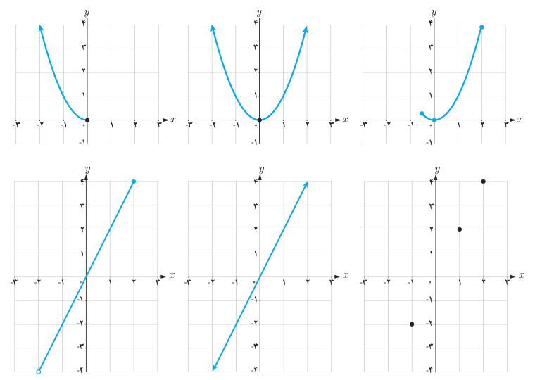

# درس ۱: آشنایی بیشتر با تابع

یک تابع از مجموعه $A$ به مجموعه $B$، رابطه‌ای بین این دو مجموعه است که در آن به هر عضو $A$، دقیقاً یک عضو از $B$ نسبت داده می‌شود. $A$ را دامنه تابع و $B$ را هم‌دامنه تابع می‌نامند. برد تابع زیرمجموعه‌ای از هم‌دامنه است.

## کار در کلاس

الف) با توجه به توابع داده شده در جدول زیر، مشخص کنید هر نمودار مربوط به کدام تابع است و جدول را نیز کامل کنید. شباهت‌ها و تفاوت‌های نمودارها را با هم مقایسه کنید.

| تابع | $f(x)=2x$ | $g(x)=2x$ | $h(x)=2x$ | $t(x)=x^2$ | $s(x)=x^2$ | $k(x)=x^2$ |
|---|---|---|---|---|---|---|
| دامنه تابع | $\mathbb R$ | $\{-1,1,2\}$ | $(-2,2]$ | $\mathbb R$ | $(-\infty,0]$ | $[-\frac12,2]$ |
| برد تابع | | | | | | |

