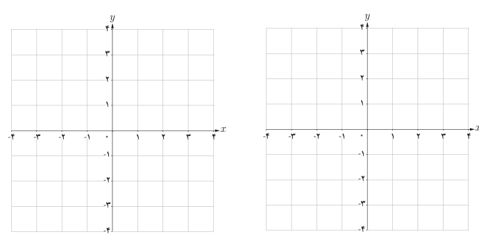

# فصل دوم: تابع — ۳۹

ب) جدول روبه‌رو را به دلخواه (متفاوت از قسمت الف) کامل و نمودار هر تابع را رسم کنید. پاسخ خود را با پاسخ دوستانتان مقایسه کنید. چند پاسخ متفاوت برای $f$ و $g$ می‌توان ارائه کرد؟

| تابع | $f(x)=2x$ | $g(x)=x^2$ |
|---|---|---|
| دامنه | | |
| برد | | |

برای مشخص بودن یک تابع باید دامنه، هم‌دامنه و دستور یا قاعده‌ای که نحوه ارتباط بین اعضای دامنه و اعضای هم‌دامنه را نشان می‌دهد معلوم باشد.

به‌طور مثال تابع $f$ در قسمت الف کار در کلاس قبل، تابعی است با دامنه $\mathbb R$ و هم‌دامنه $\mathbb R$ و ضابطه آن نیز $f(x)=2x$ است. برای سادگی و اختصار این تابع را به‌صورت مقابل نمایش می‌دهند:

$$\begin{cases}f:\mathbb R\to\mathbb R\\f(x)=2x\end{cases}\quad\text{(تابع f از R به R است.)}$$

به همین ترتیب تابع $h$ قسمت الف را می‌توان چنین نمایش داد.

$$\begin{cases}h:(-2,2]\to(-4,4]\\h(x)=2x\end{cases}$$

تابع $h$ را به‌صورت مقابل هم می‌توان معرفی کرد.

$$\begin{cases}h:(-2,2]\to\mathbb R\\h(x)=2x\end{cases}$$

در هر دو نمایش اخیر تابع $h$، دامنه مجموعه $(-2,2]$ و ضابطه آن $h(x)=2x$ است. در نمایش اول هم‌دامنه $(-4,4]$ است که همان برد تابع است. در نمایش دوم $h$، هم‌دامنه را $\mathbb R$ در نظر گرفته‌ایم. در این حالت نیز برد تابع $(-4,4]$ است.

هم‌دامنه تابع را می‌توان هر مجموعه دلخواهی شامل برد تابع در نظر گرفت.
