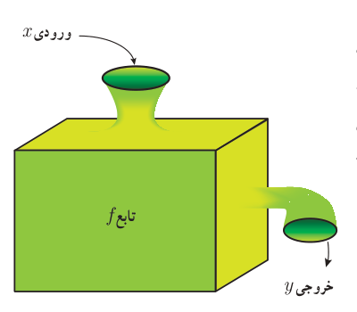
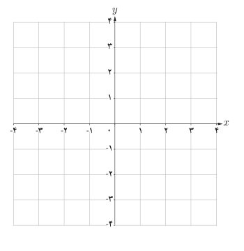

# صفحهٔ ۴۰

## کار در کلاس

برای تابع $\begin{cases}f:[0,\frac13]\to[0,\frac19]\\f(x)=x^2\end{cases}$ کدام‌یک از نمایش‌های زیر نیز قابل قبول است؟

الف) $\begin{cases}f:\mathbb R\to\mathbb R\\f(x)=x^2\end{cases}$

ب) $\begin{cases}f:[0,\frac13]\to[0,\infty)\\f(x)=x^2\end{cases}$

پ) $\begin{cases}f:\mathbb R\to[0,\frac19]\\f(x)=x\end{cases}$

ت) $\begin{cases}f:[0,\frac13]\to\mathbb R\\f(x)=x^2\end{cases}$

## تابع به عنوان یک ماشین

می‌توان تابع را همچون ماشینی در نظر گرفت که یک ورودی را دریافت می‌کند و در ازای آن یک خروجی تحویل می‌دهد. ورودی‌ها از دامنه داده می‌شوند و خروجی‌ها به برد تعلق دارند و برای هر ورودی دقیقاً یک خروجی وجود دارد (البته ممکن است چند ورودی مختلف خروجی یکسانی داشته باشند). اگر $x$ عنصری دلخواه از دامنه $f$ و $y$ نمایش خروجی نظیر آن باشد، $x$ را متغیر مستقل و $y$ را متغیر وابسته می‌نامند.

در این صورت می‌نویسیم: $y=f(x)$

## کار در کلاس

فرض کنید ماشین $f$ به عنوان ورودی، اعداد (حقیقی) را قبول می‌کند و پس از دریافت هر عدد، آن را سه برابر و سپس ۵ واحد به آن اضافه می‌کند. در این صورت به ازای ورودی ۱۰، خروجی ۳۵ را می‌دهد. به سؤالات زیر پاسخ دهید:

الف) ماشین به ازای ورودی ۲-، چه خروجی خواهد داشت؟

ب) اگر خروجی ماشین ۴ باشد ورودی آن چقدر بوده است؟

پ) نمایش تابع به‌صورت $\begin{cases}f:\mathbb R\to\mathbb R\\f(x)=\ldots\end{cases}$ است.

ت) نمودار تابع را رسم و دامنه و برد آن را معلوم کنید.

