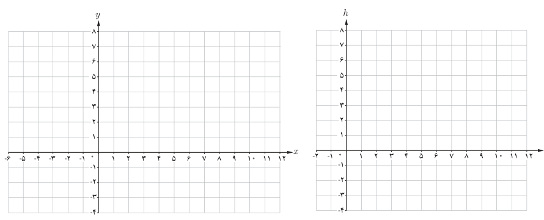
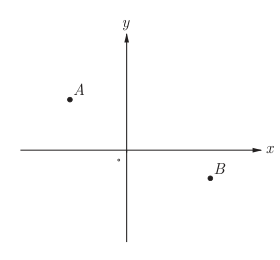

# صفحهٔ ۴۲

ب) چرا $h$ تابعی از $t$ است؟

پ) دامنه و برد این تابع را بنویسید.

ت) نمایش مقابل از تابع $h$ کامل کنید:

$$\begin{cases}h:[\quad]\to[\quad]\\h(t)=\quad\end{cases}$$

ث) نمودار تابع $h$ و نمودار تابع $y=\frac13x$ را رسم کنید و شباهت‌ها و تفاوت‌های آنها را بیان کنید.

## تمرین

۱. در صفحه مختصات روبه‌رو تابعی رسم کنید که نقاط $A$ و $B$ روی آن قرار داشته باشند. چه تعداد از این توابع وجود دارند؟

۲. کدام‌یک از موارد زیر درست و کدام‌یک نادرست است؟ دلیل بیاورید.

الف) اگر دامنه دو تابع باهم برابر و برد آنها نیز با یکدیگر برابر باشند، دو تابع برابرند.

ب) برد و هم‌دامنه تابع می‌توانند یکی باشند.

پ) هم‌دامنه تابع زیرمجموعه‌ای از برد آن است.

ت) بی‌شمار تابع وجود دارد که دامنه آن بازه $[0,3]$ است.

۳. تابعی مثال بزنید که دامنه آن مجموعه اعداد حقیقی مثبت باشد. چه تعداد از این توابع وجود دارند؟

۴. همه تابع‌های از مجموعه $A=\{a,b,c\}$ به مجموعه $B=\{d,e\}$ را بنویسید (از نمودار پیکانی کمک بگیرید).
