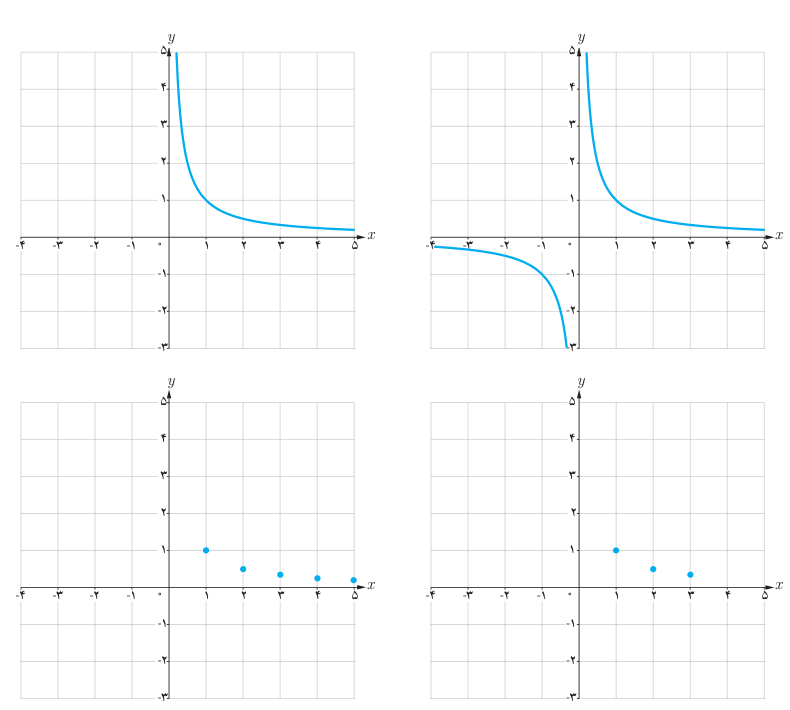

# فصل دوم: تابع — ۴۵

## کار در کلاس

مشخص کنید که هر نمودار زیر متناظر با کدام تابع است؟ دلیل بیاورید.

الف) $f:\mathbb N\to\mathbb R,\quad f(x)=\frac1x$

ب) $g:\mathbb R^+\to\mathbb R,\quad g(x)=\frac1x$

پ) $h:\{1,2,3\}\to\mathbb R,\quad h(x)=\frac1x$

ت) $t:\mathbb R-\{0\}\to\mathbb R,\quad t(x)=\frac1x$

دامنه تابع $f(x)=\frac1x$ برابر $\mathbb R-\{0\}$ است، اما ممکن است دامنه را به مجموعه‌های دیگری محدود کنیم. دامنه $f$ را با $D_f$ نمایش می‌دهیم. دامنه یک تابع گویا مجموعه همه مقادیری است که به‌ازای آنها، عبارت جبری گویای نمایش‌دهنده ضابطه تابع، تعریف‌شده باشد؛ مثلاً دامنه تابع $f(x)=\frac5{x+2}$ مجموعه $\mathbb R-\{-2\}$ است.
