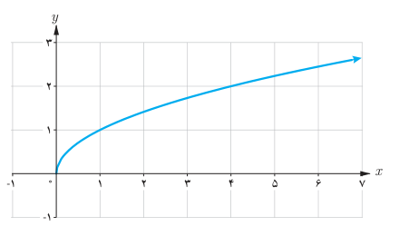
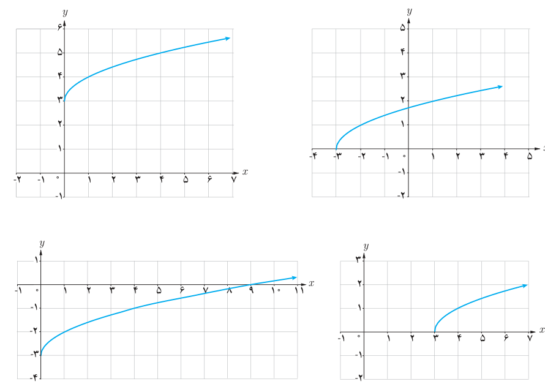

# توابع رادیکالی (تابع ریشه دوم) — صفحهٔ ۴۶

تابعی را که هر عدد نامنفی را به ریشه دوم نامنفی آن نسبت می‌دهد تابع ریشه دوم می‌نامند و به‌صورت $f(x)=\sqrt{x}$ یا $y=\sqrt{x}$ نمایش می‌دهند. نمودار تابع در شکل نشان داده شده است. دامنه و برد این تابع، بازه $[0,+\infty)$ است. تابع $f(x)=\sqrt{x}$ یک تابع رادیکالی است.

## کار در کلاس

به کمک نمودار تابع $y=\sqrt{x}$ نمودار چهار تابع:

الف) $f(x)=\sqrt{x}+3$، ب) $h(x)=\sqrt{x}-3$، پ) $g(x)=\sqrt{x-3}$، ت) $r(x)=\sqrt{x+3}$

رسم شده‌اند. تابع مربوط به هر نمودار را مشخص و دامنه و برد آن را معلوم کنید.

