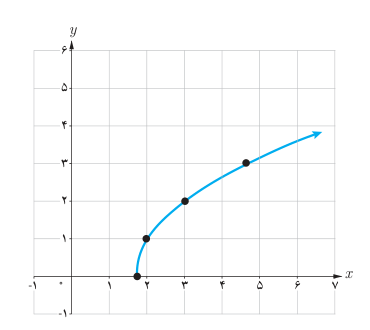
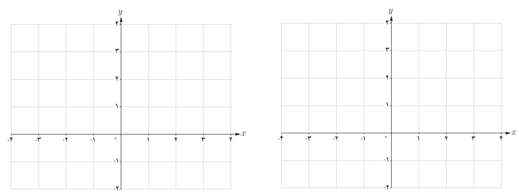

# فصل دوم: تابع — ۴۷

**مثال:** دامنه تابع $f(x)=\sqrt{3x-5}$ برابر مجموعه همه اعدادی است که برای آنها $3x-5\ge0$ و یا $x\ge\frac53$. پس: $D_f=[\frac53,+\infty)$.

برد این تابع نیز مجموعه اعداد نامنفی است یعنی: $R_f=[0,+\infty)$.

در جدول، مقادیر تابع $f$ به‌ازای چند عدد در دامنه آن مشخص و نمودار تابع نیز در زیر جدول رسم شده است.

| $x$ | $5/3$ | ۲ | ۳ | ۴ | $14/3$ |
|---|---|---|---|---|---|
| $f(x)$ | ۰ | ۱ | ۲ | $\sqrt7$ | ۳ |

## کار در کلاس

الف) دامنه تابع $f(x)=\sqrt{2x+6}$ را به‌دست آورید. سپس به کمک نقطه‌یابی نمودار آن را رسم کرده و برد تابع را نیز معلوم کنید.

ب) نمودار تابع $g(x)=\sqrt{2x+6}-2$ را به کمک انتقال رسم کنید.

## فعالیت

تابع $f(x)=7\sqrt{x}+50$ قد متوسط کودکان را، به تقریب، و برحسب سانتی‌متر تا ۶۰ ماهگی نشان می‌دهد. $x$ نشان‌دهنده ماه‌های پس از تولد است. در حالت کلی دامنه این تابع رادیکالی بازه $[0,\infty)$ است ولی در این مثال که واقعی است دامنه آن بازه $[0,60]$ می‌باشد.
