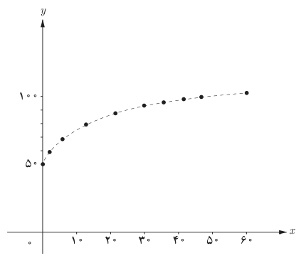

# صفحهٔ ۴۸

الف) جدول زیر را کامل کنید. در همین صفحه با استفاده از این جدول نمودار تقریبی $f$ را رسم کرده‌ایم.

| $x$ | ۰ | ۱ | ۴ | ۱۰ | ۱۶ | ۲۵ | ۳۰ | ۳۶ | ۴۹ | ۶۰ |
|---|---|---|---|---|---|---|---|---|---|---|
| $f(x)$ | ۵۰ | | | ۷۲٫۱ | | ۸۵ | ۸۸٫۳ | ۹۲ | | ۱۰۴٫۲ |

ب) برد این تابع چیست؟

پ) قد یک کودک چهار ساله تقریباً چقدر است؟

ت) با استفاده از ضابطه تابع یا نمودار آن مشخص کنید که کودکی با قد ۷۵ سانتی‌متر حدوداً چند ماهه است.

## معادلات و توابع

معادلاتی که دارای دو متغیر مانند $x$ و $y$ هستند یک رابطه را نشان می‌دهند؛ مثلاً معادله $x+y=2$ شامل همه زوج‌های مرتبی است که مجموع مؤلفه‌های آنها برابر ۲ است. نمودار این معادله یک خط است. این معادله را به‌صورت $y=-x+2$ یا $f(x)=-x+2$ نیز نمایش می‌دهند. بسیاری از توابع با یک معادله بیان می‌شوند، اما الزاماً یک معادله با دو متغیر برحسب $x$ و $y$ یک تابع را مشخص نمی‌کند.

**مثال**

الف) در معادله $-x^2+y=4$، $y$ را برحسب $x$ به‌دست آورید. آیا $y$ تابعی از $x$ است؟

**حل:** داریم $y=x^2+4$. این معادله یک سهمی را مشخص می‌کند که همان تابع $f(x)=x^2+4$ است.

ب) آیا در معادله $x-y^2=4$، $y$ تابعی از $x$ است؟

**حل:** اگر $y$ را برحسب $x$ به‌دست آوریم داریم: $y=\pm\sqrt{x-4}$. به‌ازای $x=5$ داریم: $y=\pm1$. یعنی نقاط $(5,1)$ و $(5,-1)$ روی نمودار معادله قرار دارند. بنابراین، این معادله یک تابع را نمایش نمی‌دهد.
