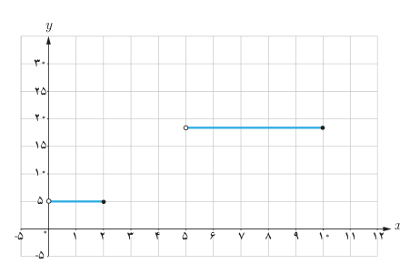

# فصل دوم: تابع — ۴۹

## کار در کلاس

کدام‌یک از معادلات زیر یک تابع را مشخص می‌کند؟ دلیل بیاورید.

الف) $y=|x|+1$  
ب) $x=|y|+1$

## تابع پله‌ای ـ تابع جزء صحیح

هزینه ارسال بسته‌های پستی به‌طور معمول تابعی از وزن آنهاست. هزینه توقف خودرو در یک توقفگاه (پارکینگ) نیز تابعی از زمان توقف است. در فعالیت زیر با نمونه‌ای از این توابع آشنا می‌شویم.

## فعالیت

هزینه ارسال یک بسته پستی به مقصدی معین در جدول زیر داده شده است.

| $x$ (وزن بسته) کیلوگرم | $0<x\le2$ | $2<x\le5$ | $5<x\le10$ | $10<x\le12$ |
|---|---|---|---|---|
| $f(x)$ (هزینه ارسال) برحسب هزار تومان | ۵ | ۱۰ | ۱۷ | ۲۰ |

اگر حداکثر وزن بسته‌های ارسالی ۱۲ کیلوگرم باشد،

الف) ضابطه تابعی را که جدول فوق نشان می‌دهد بنویسید و دامنه و برد آن را به‌دست آورید:

$$f(x)=\begin{cases}5&0<x\le2\\\quad&\quad\\\quad&\quad\\\quad&\quad\end{cases}$$

ب) برای ارسال دو بسته به وزن‌های ۹ کیلوگرم و ۱۱٫۵ کیلوگرم چه هزینه‌ای باید پرداخت؟

پ) قسمتی از نمودار این تابع در شکل روبه‌رو رسم شده است. بقیه نمودار را رسم کنید.

توابعی مانند تابع فوق را که بتوان دامنه آنها را به تعدادی بازه تقسیم کرد به‌گونه‌ای که تابع روی هر کدام از این بازه‌ها ثابت باشد، تابع پله‌ای می‌نامند.
