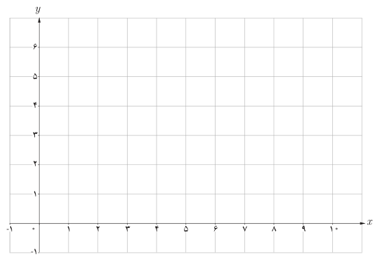
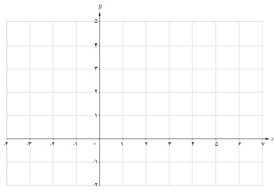

# صفحهٔ ۵۰

## کار در کلاس

۱. توقفگاه (پارکینگ) یک مجتمع تفریحی ـ ورزشی برای چهار ساعت اول توقف یک خودرو ۳ هزار تومان و برای هر دو ساعت اضافه یا زمانی کمتر از آن ۱۰۰۰ تومان دریافت می‌کند. اگر حداکثر مدت توقف در این توقفگاه ده ساعت باشد، نمودار تابعی را که هزینه توقف را به‌ازای همه ساعات ممکن نشان دهد رسم کنید. دامنه و برد تابع را نیز مشخص کنید.

$$f(x)=\begin{cases}3&0<x\leq4\\ & \end{cases}$$

۲. نمودار تابع پله‌ای زیر را رسم کنید:

$$f(x)=\begin{cases}2&-3\leq x\leq-2\\-1&-2<x\leq0\\4&0<x\leq4\\0&4<x<5\end{cases}$$

گونه خاصی از توابع پله‌ای که دارای کاربردهای زیادی نیز هست تابع **جزء صحیح** نام دارد. ابتدا با جزء صحیح یک عدد آشنا می‌شویم.

برای هر عدد حقیقی مانند $x$، جزء صحیح آن بزرگ‌ترین عدد صحیحی است که از $x$ بیشتر نباشد. جزء صحیح $x$ را با نماد $[x]$ نمایش می‌دهیم، به‌طور مثال $[-2.8]=-3$ و $[3.49]=3$. مطابق با تعریف، جزء صحیح یک عدد همواره $[x]\leq x$؛ اگر $x$ یک
