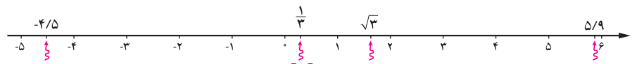
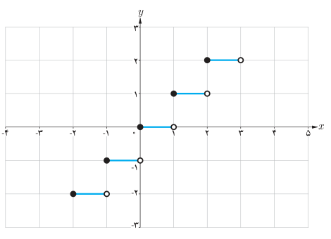
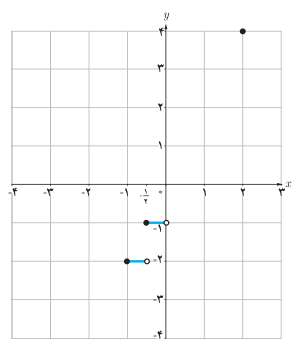

# صفحهٔ ۵۱ ـ فصل دوم: تابع

عدد صحیح باشد $[x]=x$. جزء صحیح اعداد نشان داده شده روی محور را بیابید.

$$[-4.5]=\qquad [\tfrac13]=\qquad [\sqrt3]=\qquad [5.9]=$$

تابعی که به هر عدد حقیقی $x$، جزء صحیح آن را نسبت می‌دهد تابع جزء صحیح نامیده می‌شود و آن را به صورت $f(x)=[x]$ نمایش می‌دهند. $D_f=\mathbb R$ و $R_f=\mathbb Z$. نمودار تابع با توجه به جدول در بازهٔ $[-2,3)$ رسم شده است.

| $x$ | $y=[x]$ |
|---|---|
| $-2\leq x<-1$ | $y=-2$ |
| $-1\leq x<0$ |  |
| $0\leq x<1$ |  |
| $1\leq x<2$ |  |
| $2\leq x<3$ |  |

## کار در کلاس

۱. نمودار تابع $f(x)=[2x]$ را در بازهٔ $[-1,2]$ رسم کنید (جدول و نمودار داده شده را کامل کنید).

$$-1\leq x\leq2\Rightarrow -2\leq2x\leq4$$

| $2x$ | $-2\leq2x<-1$ | $-1\leq2x<0$ |  |  | $2\leq2x<3$ |  |
|---|---|---|---|---|---|---|
| $[2x]$ | $-2$ |  | $0$ | $1$ |  |  |
| $x$ | $-1\leq x<-\frac12$ | $-\frac12\leq x<0$ |  |  |  | $\frac32\leq x<2$ |

