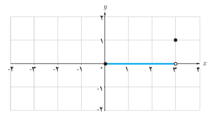
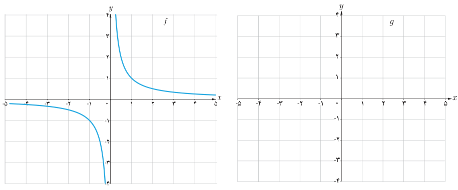

# صفحهٔ ۵۲

۲. نمودار تابع $f(x)=[\frac13x]$ را در بازهٔ $[-3,3]$ رسم کنید (کامل کنید).

$$0\leq\frac13x<1\Rightarrow\begin{cases}[\frac13x]=0\\0\leq x<3\end{cases}$$
$$-1\leq\frac13x<0\Rightarrow$$

## تمرین

۱. دامنه توابع زیر را بیابید.

الف) $f(x)=\frac{x-1}{2-x}$ ؛ ب) $f(x)=\frac{-3x}{x^2+1}$ ؛ پ) $f(x)=\frac{2x+3}{x^2+x-12}$

ت) $f(x)=\sqrt{3x+1}$ ؛ ث) $f(x)=2\sqrt{x}-3$ ؛ ج) $f(x)=\sqrt{8-x}$

۲. توضیح دهید که چگونه با استفاده از نمودار تابع $f(x)=\frac1x$ می‌توان نمودار تابع $g(x)=-\frac1x$ را رسم کرد.

۳. نمودار تابع $y=-\sqrt{x}$ را با استفاده از نمودار تابع $y=\sqrt{x}$ رسم کنید.
