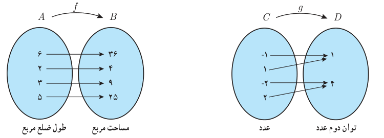

# درس ۳: وارون توابع

## فعالیت

دو تابع $f$ و $g$ را در نظر بگیرید:

الف) $f$ و $g$ را به‌صورت زوج‌های مرتب نمایش دهید و دامنه و برد هر یک را بنویسید.

$$f=\qquad g=$$
$$D_f=\qquad D_g=$$
$$R_f=\qquad R_g=$$

ب) اگر جای دو مؤلفه هر زوج مرتب در $f$ و $g$ را عوض کنیم، روابط جدیدی به‌دست می‌آید. آنها را به ترتیب $h$ و $k$ بنامید. $h$ و $k$ را وارون رابطه‌های $f$ و $g$ می‌نامیم. $h$ و $k$ را به‌صورت مجموعه زوج‌های مرتب بنویسید.

$$h=\qquad k=$$

کدام‌یک از رابطه‌های $h$ و $k$ تابع است؟ دلیل بیاورید.

اگر رابطه بین دو مجموعه به‌صورت زوج‌های مرتب داده شده باشد، رابطه‌ای را که از جابه‌جایی دو مؤلفه هر زوج مرتب رابطه به‌دست می‌آید وارون آن رابطه می‌نامیم.

اگر $f$ یک تابع باشد وارون آن را با $f^{-1}$ نمایش می‌دهیم و به‌صورت زیر تعریف می‌کنیم:

$$f^{-1}=\{(y,x)\mid(x,y)\in f\}$$

اگر $f^{-1}$ تابع باشد آن‌گاه $f$ را وارون‌پذیر (معکوس‌پذیر) و $f^{-1}$ را «تابع وارون» $f$ می‌نامیم.

توجه کنید که $f^{-1}$ را نباید با $\frac1f$ اشتباه گرفت.
