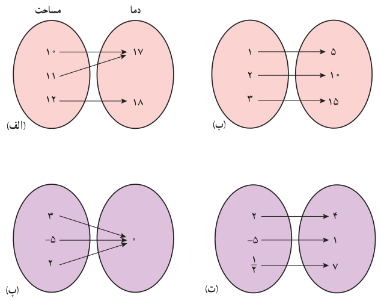
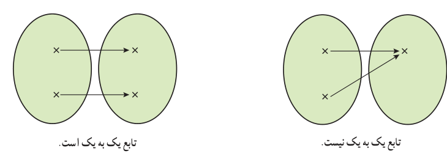

# صفحهٔ ۵۵ ـ فصل دوم: تابع

## توابع یک‌به‌یک

چه توابعی وارون‌پذیرند؟ در فعالیت قبل تابع $f$ وارون‌پذیر بود ولی تابع $g$ وارون‌پذیر نبود. بنابراین سؤال اساسی این است که یک تابع باید چه شرطی داشته باشد تا وارون‌پذیر باشد؟

## فعالیت

توابع زیر را در نظر بگیرید:

الف) کدام‌یک از آنها وارون‌پذیرند؟

ب) ویژگی مشترک توابع وارون‌پذیر چیست؟

اگر $f$ یک تابع باشد و به هر عنصر در برد دقیقاً یک عنصر از دامنه نظیر شود تابع وارون‌پذیر است. اگر تابعی چنین ویژگی داشته باشد آن را یک به یک نامیم. به عبارت دیگر تابع $f$ یک به یک است هرگاه هر دو عنصر متمایز در دامنه، به دو عنصر متمایز در برد نظیر شوند.

همان‌گونه که در فعالیت بالا دیده شد، اگر تابعی یک‌به‌یک باشد آن‌گاه وارون‌پذیر است.

