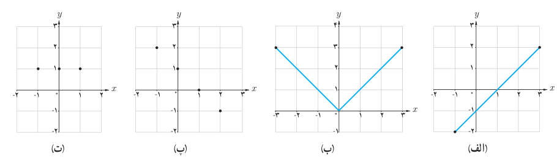
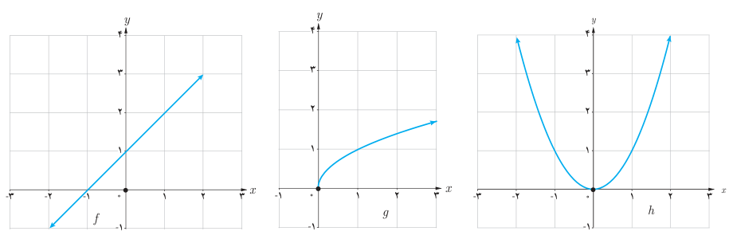

# صفحهٔ ۵۶

## فعالیت

توابع داده شده در (الف) و (پ) یک به یک هستند ولی توابع داده شده در (ب) و (ت) یک به یک نیستند. چرا؟ توضیح دهید.

به‌طور کلی می‌توان گفت که یک تابع در صورتی یک به یک است که هر خط موازی محور $x$ها، نمودار آن را حداکثر در یک نقطه قطع کند.

## کار در کلاس

۱. کدام‌یک از توابع زیر یک به یک هستند؟

$$k=\{(1,2),(3,4),(8,9)\}$$
$$l=\{(3,7),(2,5),(1,5)\}$$

۲. فرض کنید به هر یک از اعضای یک کلاس کد ملی آنها را نسبت دهیم. توضیح دهید که چگونه رابطه بین افراد و کد ملی آنها تابعی یک به یک را معلوم می‌کند.
